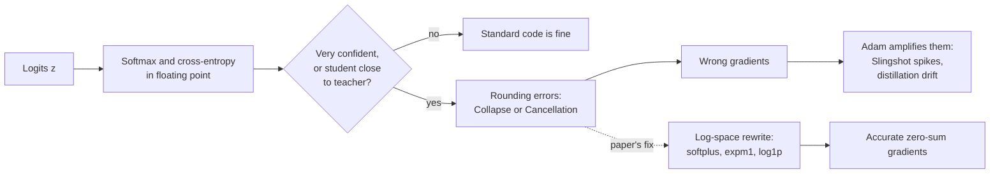
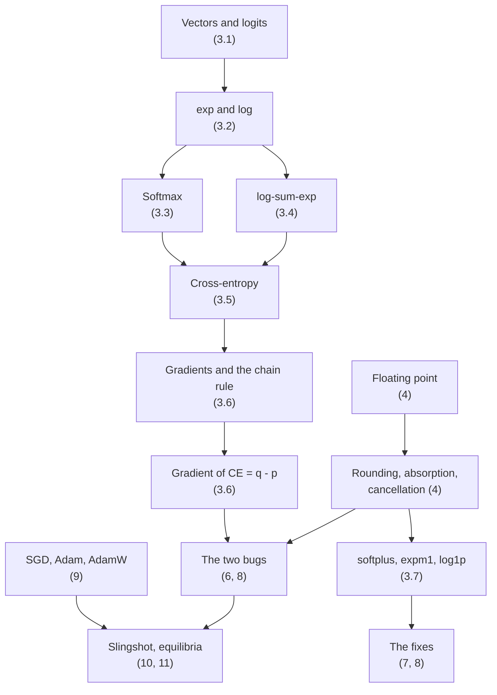
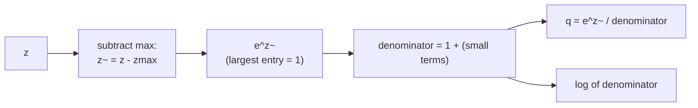
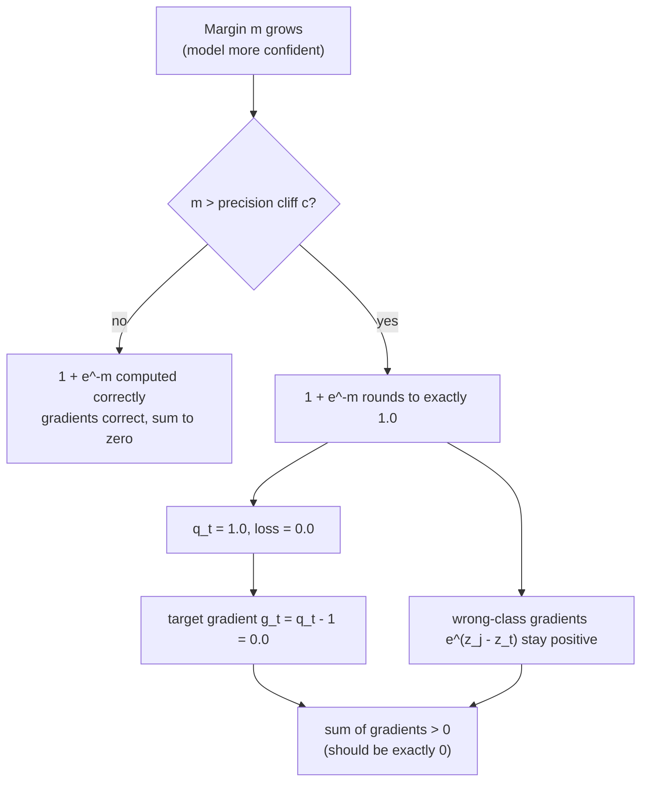
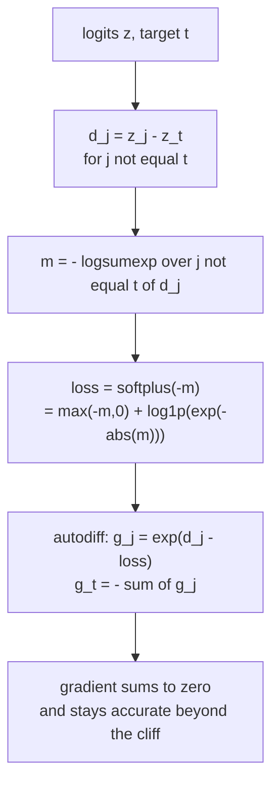
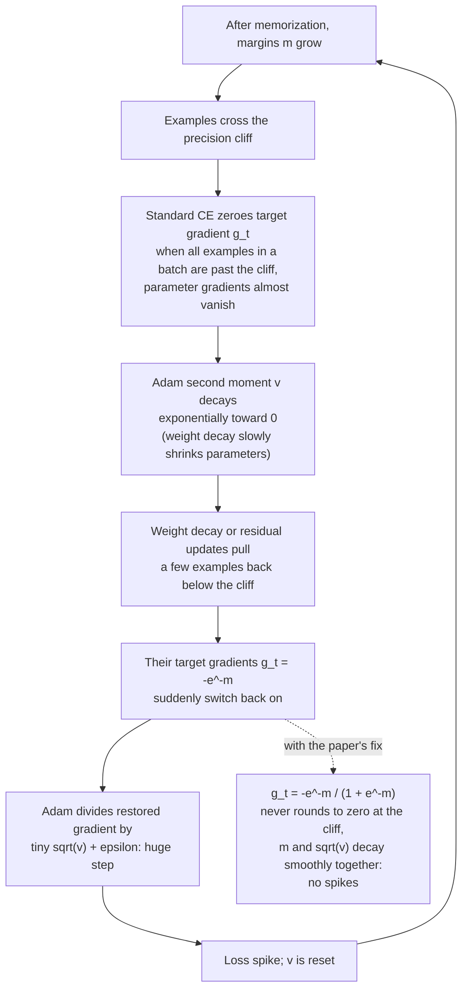

# A Beginner's Guide to "A Fix for Softmax and Cross-Entropy"

An explanatory walkthrough of the paper, written for readers who know basic programming and school-level algebra. Every mathematical and computer-science idea the paper relies on is introduced before it is used.

| | |
|---|---|
| **Paper** | A Fix for Softmax and Cross-Entropy |
| **Authors** | Jonathan T. Barron, Dan Gnanapragasam, Michael Tschannen (Google DeepMind) |
| **arXiv** | [arXiv:2610.31642v1](https://arxiv.org/abs/2610.31642v1) [cs.LG], submitted 2026-10-22 |
| **License of the paper** | CC BY 4.0 |
| **This guide written** | 2026-10-24 |

> **Scope and honesty note.** This guide explains the paper; it is not the paper. All equations, experimental settings and numbers attributed to the paper were taken from its arXiv HTML version (v1). The small NumPy script in [Section 13](#13-runnable-demo-numpy-only) was written for this guide and was executed to produce the printed output shown there. It reproduces the two numerical bugs and the fixes at the level of single examples. It does **not** reproduce the paper's training experiments (grokking, Slingshot, distillation), and it does not test PyTorch, JAX or TensorFlow themselves. The paper is a v1 preprint; check later versions for corrections.

---

## Table of contents

1. [The paper in one minute](#1-the-paper-in-one-minute)
2. [Prerequisite map](#2-prerequisite-map)
3. [Foundations: the maths](#3-foundations-the-maths)
4. [Foundations: computer science (floating point)](#4-foundations-computer-science-floating-point)
5. [Standard softmax and cross-entropy, and why they shift by the maximum](#5-standard-softmax-and-cross-entropy-and-why-they-shift-by-the-maximum)
6. [Bug 1: Softmax Collapse](#6-bug-1-softmax-collapse)
7. [The fix for Softmax Collapse](#7-the-fix-for-softmax-collapse)
8. [Bug 2: Softmax Cancellation, and its fix](#8-bug-2-softmax-cancellation-and-its-fix)
9. [Optimizer background: SGD, Adam, AdamW](#9-optimizer-background-sgd-adam-adamw)
10. [Grokking and the Slingshot mechanism](#10-grokking-and-the-slingshot-mechanism)
11. [Margin equilibria: why the margin stops at log(1/epsilon)](#11-margin-equilibria-why-the-margin-stops-at-log1epsilon)
12. [Experiments and results](#12-experiments-and-results)
13. [Runnable demo (NumPy only)](#13-runnable-demo-numpy-only)
14. [Limits and caveats](#14-limits-and-caveats)
15. [Practice questions](#15-practice-questions)
16. [Glossary](#16-glossary)
17. [References](#17-references)

---

## 1. The paper in one minute

A classifier network outputs a list of raw scores, called **logits**, one per class. **Softmax** turns logits into probabilities, and **cross-entropy** measures how far those probabilities are from the correct answer. Training needs the **gradient** of that loss, and for softmax plus cross-entropy the gradient is simply "predicted probabilities minus target probabilities".

The paper shows that the standard way of computing these quantities in floating-point arithmetic contains two bugs:

| Bug | When it happens | What goes wrong |
|---|---|---|
| **Softmax Collapse** | The model is very confident and correct (one logit is far above the rest) | The gradient on the correct class is rounded to exactly `0`, while the gradients on the wrong classes stay non-zero. The gradient no longer sums to zero. |
| **Softmax Cancellation** | Knowledge distillation, when student logits are almost equal to teacher logits | Two nearly equal probabilities are subtracted, losing precision. The result can be non-zero even when student and teacher logits are identical. |

The authors give replacement implementations of log-softmax, softmax and cross-entropy that avoid both problems by working in log space with `softplus`, `expm1` and `log1p`. They then argue that several previously reported training oddities (the "Slingshot" loss spikes during "grokking") are consequences of Softmax Collapse interacting with the Adam optimizer, and that with the fix, the confidence of the model (its logit margin) settles at a value set by Adam's `epsilon`: roughly `log(1/epsilon)`.



---

## 2. Prerequisite map

Read the foundations in this order. Each box is explained in the section shown.



---

## 3. Foundations: the maths

### 3.1 Vectors, classes and logits

A **vector** is an ordered list of numbers. Write $\mathbf{z} \in \mathbb{R}^K$ for a list of $K$ real numbers $z_1, \dots, z_K$.

In classification with $K$ classes, a neural network ends with a layer that outputs one number per class. These raw scores are the **logits**. They can be negative, positive, large or small, and they do not sum to 1. Example for $K=3$ classes (cat, dog, bird):

$$\mathbf{z} = [2.0,\ 1.0,\ 0.0]$$

A larger logit means the network favours that class more.

### 3.2 The exponential and the logarithm

* $e^x$ (also written $\exp(x)$) is the exponential function, with $e \approx 2.718$. It is always positive, equals $1$ at $x=0$, is tiny for very negative $x$ and explodes for large positive $x$.
* $\log(x)$ is the **natural logarithm**, the inverse of $e^x$: $\log(e^x) = x$ and $e^{\log x} = x$. It is only defined for $x>0$.
* Key identities used throughout the paper:

$$e^{a+b} = e^a e^b, \qquad \log(ab) = \log a + \log b, \qquad \log\frac{a}{b} = \log a - \log b, \qquad e^{-x} = \frac{1}{e^{x}}$$

A few reference values you will meet later:

| $x$ | $e^{x}$ |
|---|---|
| 0 | 1 |
| -5.5 | 0.0041 |
| -16.6 | 6.2e-8 |
| -18 | 1.5e-8 |
| -36.7 | 1.1e-16 |

### 3.3 Softmax

**Softmax** converts logits into a **probability distribution** (all entries positive, summing to 1):

$$q_k = \mathrm{softmax}(\mathbf{z})_k = \frac{e^{z_k}}{\sum_{j=1}^{K} e^{z_j}}$$

For $\mathbf{z}=[2,1,0]$: the exponentials are $[7.389,\ 2.718,\ 1.000]$, their sum is $11.107$, so $\mathbf{q} \approx [0.665,\ 0.245,\ 0.090]$.

Useful property: **softmax does not change if you add the same constant $c$ to every logit**, because $e^{z_k + c} = e^{z_k} e^{c}$ and the factor $e^c$ cancels between numerator and denominator. Section 5 uses this.

A **probability distribution over $K$ classes** is a vector with non-negative entries that sum to 1. The set of all such vectors is called the **probability simplex**, written $\Delta^{K-1}$ in the paper.

### 3.4 log-sum-exp (LSE) and log-softmax

$$\mathrm{LSE}(\mathbf{z}) = \log \sum_{j} e^{z_j}$$

Taking the log of the softmax formula gives **log-softmax**:

$$\log q_k = z_k - \mathrm{LSE}(\mathbf{z})$$

The paper writes this as $\mathrm{logsoftmax}(\mathbf{z})_k$. Log-softmax is preferred in practice because probabilities can be astronomically small, and logs of them stay in a comfortable range (for example $-18$ instead of $1.5\times10^{-8}$).

### 3.5 Cross-entropy, hard targets and soft targets

A **target distribution** $\mathbf{p}$ says what the right answer is.

* **Hard target** (a single correct class $t$): $\mathbf{p}$ is **one-hot**: $p_t = 1$ and every other $p_k = 0$. Example for $t=1$, $K=3$: $\mathbf{p}=[0,1,0]$.
* **Soft target**: $\mathbf{p}$ is any distribution, for example another network's softmax output (used in distillation, Section 8).

**Cross-entropy** between target $\mathbf{p}$ and logits $\mathbf{z}$:

$$\mathcal{L}(\mathbf{z},\mathbf{p}) = -\sum_{k} p_k \,\mathrm{logsoftmax}(\mathbf{z})_k$$

For a hard target this collapses to a single term:

$$\mathcal{L}(\mathbf{z},t) = -\log q_t = -z_t + \mathrm{LSE}(\mathbf{z})$$

Intuition: the loss is the "surprise" of the model at seeing the correct class. If $q_t = 1$, surprise is $0$. If $q_t$ is small, the loss is large.

### 3.6 Gradients, the chain rule, and why the gradient is $\mathbf{q}-\mathbf{p}$

A **gradient** $\nabla_{\mathbf{z}}\mathcal{L}$ is the vector of partial derivatives $\partial \mathcal{L}/\partial z_j$: how much the loss changes if you nudge logit $z_j$. Training moves parameters in the direction that decreases the loss, so wrong gradients mean wrong training.

The **chain rule** says that if $y=f(g(x))$ then $dy/dx = f'(g(x))\,g'(x)$. Frameworks apply it automatically (**automatic differentiation**, or **autodiff**).

Derivation of the paper's $\mathbf{g}=\mathbf{q}-\mathbf{p}$ (assuming $\sum_k p_k = 1$):

1. $\mathcal{L} = -\sum_k p_k\,(z_k - \mathrm{LSE}(\mathbf{z}))= -\sum_k p_k z_k + \mathrm{LSE}(\mathbf{z})\sum_k p_k = -\sum_k p_k z_k + \mathrm{LSE}(\mathbf{z})$.
2. $\partial(-\sum_k p_k z_k)/\partial z_j = -p_j$.
3. $\partial \mathrm{LSE}/\partial z_j = e^{z_j}/\sum_i e^{z_i} = q_j$.
4. Therefore $\partial\mathcal{L}/\partial z_j = q_j - p_j$.

So the gradient is "predicted probability minus target probability". Two consequences that matter for the paper:

* For a hard target, $g_t = q_t - 1 \le 0$ and $g_j = q_j \ge 0$ for $j\ne t$.
* **The gradient entries sum to zero**: $\sum_k (q_k - p_k) = 1 - 1 = 0$. This reflects the fact that adding a constant to all logits does not change the loss (Section 3.3), so the loss cannot have a slope in that direction. The paper treats $\sum_k g_k = 0$ as a correctness check, and shows that the standard implementation violates it.

### 3.7 `softplus`, `expm1` and `log1p`

Three small functions that the fix is built from:

| Function | Definition | Why it exists |
|---|---|---|
| $\mathrm{softplus}(x)$ | $\log(1+e^{x})$ | A smooth version of $\max(0,x)$. Implemented stably as $\max(x,0)+\mathrm{log1p}(e^{-\lvert x\rvert})$. |
| $\mathrm{log1p}(x)$ | $\log(1+x)$ | Accurate when $x$ is tiny, because it never forms the sum $1+x$ explicitly. |
| $\mathrm{expm1}(x)$ | $e^{x}-1$ | Accurate when $x$ is tiny, because it never forms the difference $e^x - 1$ explicitly. |

Why do these matter? Because computing `log(1 + 1e-20)` naively gives `0.0` (the `1e-20` is swallowed), while `log1p(1e-20)` correctly gives `1e-20`. Section 4 explains the swallowing.

### 3.8 The logit margin (the paper's measure of confidence)

For a hard target $t$, the paper defines the **logit margin**:

$$m = z_t - \log\sum_{j\ne t} e^{z_j}$$

Read it as "how far the correct logit sits above the combined weight of all the wrong logits". It has a clean consequence:

$$q_t = \frac{e^{z_t}}{e^{z_t}+\sum_{j\ne t}e^{z_j}} = \frac{1}{1+e^{-m}}, \qquad \mathcal{L}(\mathbf{z},t)=\log(1+e^{-m})=\mathrm{softplus}(-m)$$

and the exact gradient on the correct class is

$$g_t = q_t - 1 = -\frac{e^{-m}}{1+e^{-m}}$$

So as $m$ grows (more confident), the loss and $g_t$ shrink like $e^{-m}$: exponentially fast.

---

## 4. Foundations: computer science (floating point)

Computers store real numbers approximately, in **floating-point** format: a sign, an exponent, and a fixed number of fraction (mantissa) bits.

```
 fp32 layout (32 bits)
 +------+----------------+-------------------------------+
 | sign | exponent (8)   | fraction (23 bits)            |
 +------+----------------+-------------------------------+
   value = (-1)^sign  x  1.fraction  x  2^(exponent - 127)
```

| Format | Total bits | Exponent bits | Fraction bits $p$ | Typical use |
|---|---|---|---|---|
| bf16 (bfloat16) | 16 | 8 | 7 | Neural-network training on accelerators |
| fp32 (float32) | 32 | 8 | 23 | Default training precision |
| fp64 (float64) | 64 | 11 | 52 | Scientific computing, "high precision" |

### 4.1 Two different limits: range versus precision

* **Range** (set by the exponent): the largest and smallest magnitudes you can store. In fp32, $e^{z}$ overflows to infinity for $z\gtrsim 88$, and values below about $10^{-38}$ underflow to zero (denormals extend slightly further).
* **Precision** (set by the fraction bits): how finely numbers can be told apart. Spacing between neighbouring numbers is **relative**: near $1$ the spacing is $2^{-p}$, near $10^{-30}$ it is about $10^{-30}\cdot 2^{-p}$.

This asymmetry is the heart of the paper: *floating point is extremely fine-grained near 0 but coarse near 1*. A number like $10^{-20}$ is stored perfectly, but $1 + 10^{-20}$ cannot be stored; it is rounded to exactly $1$.

### 4.2 Absorption (a tiny number added to a big one disappears)

Rounding goes to the nearest representable number (ties go to the one with an even last bit). Near $1$ the spacing is $2^{-p}$, so adding $x$ to $1$ returns $1$ whenever $x \le 2^{-(p+1)}$, which is half the spacing.

| Format | $2^{-(p+1)}$ | Adding a smaller value to 1.0 returns 1.0 |
|---|---|---|
| bf16 | $2^{-8} \approx 3.9\times10^{-3}$ | yes |
| fp32 | $2^{-24} \approx 6.0\times10^{-8}$ | yes |
| fp64 | $2^{-53} \approx 1.1\times10^{-16}$ | yes |

Try it: in NumPy, `np.float32(1.0) + np.float32(3e-8) == np.float32(1.0)` evaluates to `True`.

### 4.3 Catastrophic cancellation (subtracting nearly equal numbers)

If two numbers are almost equal and each carries a small rounding error, their difference keeps the *errors* while losing the *signal*. Decimal analogy with 7 significant digits:

```
  0.6652410      (true value 0.66524100001)
- 0.6652409      (true value 0.66524090002)
  ---------
  0.0000001      (true difference 0.00000009999, but only ~1 digit survives)
```

In softmax terms: if student and teacher probabilities each carry relative error about $10^{-7}$, and they differ by only about $10^{-7}$, the subtraction $q_k - p_k$ is mostly noise.

### 4.4 The precision cliff, derived

Combine Sections 3.8 and 4.2. In the standard code the denominator is formed as $1 + e^{-m}$. That sum evaluates to exactly $1.0$ when

$$e^{-m} \le 2^{-(p+1)} \iff m \ge (p+1)\ln 2 =: c_d$$

The paper calls $c_d$ the **precision cliff** and reports $c_{16}\approx 5.5$ (bf16), $c_{32}\approx 16.6$ (fp32), $c_{64}\approx 36.7$ (fp64). The formula reproduces them:

| Format | $p$ | $(p+1)\ln 2$ |
|---|---|---|
| bf16 | 7 | 5.55 |
| fp32 | 23 | 16.64 |
| fp64 | 52 | 36.74 |

```
 margin m  0 ----- 5.5 ------------- 16.6 --------------------------- 36.7 ---->
                    ^                  ^                               ^
                bf16 cliff         fp32 cliff                      fp64 cliff
                (gradient on the correct class becomes 0 beyond these points
                 in the standard implementation)
```

---

## 5. Standard softmax and cross-entropy, and why they shift by the maximum

Computing $e^{z_k}$ directly overflows if some $z_k > 88$ in fp32. Standard libraries (the paper cites Higham, 2002) therefore subtract the largest logit $z_{\max}=\max_j z_j$ first. By the shift-invariance of Section 3.3 this changes nothing mathematically (this is the paper's Equation 1):

$$\tilde z_k = z_k - z_{\max},\qquad \mathrm{logsoftmax}(\mathbf{z})_k=\tilde z_k-\log\sum_j e^{\tilde z_j},\qquad q_k=\frac{e^{\tilde z_k}}{\sum_j e^{\tilde z_j}}$$

After the shift every exponent is $\le 0$, so no overflow occurs, and the largest term is exactly $e^0=1$, so the denominator is at least 1 and never zero.



That "$1 + \text{(small terms)}$" is exactly where Softmax Collapse enters.

---

## 6. Bug 1: Softmax Collapse

### 6.1 What happens

Suppose the model is confident and correct: the target logit is the largest, $z_t = z_{\max}$. After the shift:

* the target entry becomes exactly $\tilde z_t = 0$, so $e^{\tilde z_t}=1$;
* the denominator is $1 + \sum_{j\ne t} e^{z_j - z_t} = 1+e^{-m}$.

When the margin passes the cliff, $m>c_d$, the sum $1+e^{-m}$ **rounds to exactly 1.0**. Then in the standard implementation:

* forward pass: $q_t = 1/1 = 1$, loss $=-\log 1 = 0$;
* backward pass: $\tilde g_t = q_t - 1 = 0$.

But the wrong-class gradients are computed as $\tilde g_j = e^{z_j - z_t}/(1+e^{-m})$. The numerator is a small number evaluated directly (no "$1+$" in front of it), so it is stored accurately all the way down to underflow (around $m\approx 88$ in fp32). The result (the paper's Equation 4):

$$\tilde g_k=\mathbf 1[k\ne t]\,g_k,\qquad \sum_k \tilde g_k = -g_t=\frac{e^{-m}}{1+e^{-m}}>0 \quad (m>c_d)$$

where $\mathbf 1[k\ne t]$ is 1 for wrong classes and 0 for the target. The target's share of the gradient has been deleted, so the gradient is no longer zero-sum. The same happens in standalone softmax: the gradient on the arg-max entry is rounded to 0 while the others stay positive.



### 6.2 Worked example with real numbers

Take $\mathbf z=[9,-9,-9]$, target $t=0$, in fp32.

| Step | Value |
|---|---|
| Shifted logits $\tilde{\mathbf z}$ | $[0,\ -18,\ -18]$ |
| Exponentials | $[1,\ 1.523\times10^{-8},\ 1.523\times10^{-8}]$ |
| Margin $m = 9-\log(2e^{-9}) = 18-\ln 2$ | $17.307$ (above $c_{32}=16.64$) |
| $e^{-m}$ (true) | $3.046\times10^{-8}$ |
| Half-spacing of fp32 near 1 | $5.96\times10^{-8}$, which is larger than $e^{-m}$ |
| Denominator in fp32 | $1 + 3.046\times10^{-8}$ rounds to $1.0$ |
| Standard loss, $g_0$ | $0.0$ and $0.0$ (true values: $3.046\times10^{-8}$ and $-3.046\times10^{-8}$) |
| Standard $g_1, g_2$ | $1.523\times10^{-8}$ each, so $\sum g = 3.046\times10^{-8}\neq 0$ |

The demo in [Section 13](#13-runnable-demo-numpy-only) prints exactly these numbers.

---

## 7. The fix for Softmax Collapse

**Idea:** never add 1 to $e^{-m}$ directly. Compute the margin $m$ separately from the log-sum-exp of the *non-largest* entries, and finish with the numerically stable $\mathrm{softplus}(-m)=\log(1+e^{-m})$.

Paper's Equation 5, for log-softmax (with $i_{\max}=\arg\max_i z_i$):

$$\tilde z_k=\mathbf 1[k\ne i_{\max}]\,(z_k-z_{i_{\max}}),\qquad m=-\mathrm{LSE}_{j\ne i_{\max}}\tilde z_j,\qquad \mathrm{logsoftmax}(\mathbf z)_k=\tilde z_k-\mathrm{softplus}(-m)$$

The arg-max slot is set to the constant $0$ (not $z_{i_{\max}}-z_{i_{\max}}$), and softmax is defined as $\exp(\mathrm{logsoftmax}(\mathbf z))$.

For hard-target cross-entropy the target $t$ replaces $i_{\max}$ and no arg-max is needed (Equation 6):

$$m=-\mathrm{LSE}_{j\ne t}(z_j-z_t),\qquad \mathcal L(\mathbf z,t)=\mathrm{softplus}(-m)$$

### Why this repairs the gradient

1. $z_t$ now enters the loss **only through the differences** $z_j - z_t$ for $j\neq t$. Anything that depends only on differences is unchanged by a uniform shift, so autodiff produces a gradient that sums to zero. Concretely, $g_t=-\sum_{j\ne t}g_j$.
2. The derivative of $\mathrm{softplus}(-m)$ is $-\sigma(-m)=-\dfrac{e^{-m}}{1+e^{-m}}$, which keeps $e^{-m}$ **in the numerator**. Even when the denominator rounds to $1.0$, dividing $-e^{-m}$ by $1.0$ preserves the value, down to underflow (Equation 7):

$$g_j=\frac{e^{z_j-z_t}}{1+e^{-m}}\ (j\ne t),\qquad g_t=-\sum_{j\ne t}g_j=-\frac{e^{-m}}{1+e^{-m}}$$



For the example $\mathbf z=[9,-9,-9]$ the fixed version returns loss $3.046\times10^{-8}$ and gradient $[-3.046\times10^{-8},\ 1.523\times10^{-8},\ 1.523\times10^{-8}]$, which sums to zero.

---

## 8. Bug 2: Softmax Cancellation, and its fix

### 8.1 Background: knowledge distillation, temperature and KL divergence

* **Knowledge distillation** (Hinton et al., 2015): a small **student** network is trained to imitate a large **teacher** network. The teacher's output distribution $\mathbf p=\mathrm{softmax}(\mathbf z_T)$ is used as a *soft target* for the student's logits $\mathbf z_S$.
* **Temperature $T$**: logits are divided by $T$ before softmax, $\mathrm{softmax}(\mathbf z/T)$. A larger $T$ flattens the distribution so that $\mathbf p$ does not become one-hot. (The paper uses $T=4$ in its distillation experiment, which divides the margin by 4 and keeps it below $c_{16}$.)
* **KL divergence** $\mathrm{KL}(\mathbf p\parallel\mathbf q)=\sum_k p_k\log(p_k/q_k)$ measures how different two distributions are. It is $0$ only when $\mathbf p=\mathbf q$. Since $\mathrm{KL}(\mathbf p\parallel\mathbf q)=\text{CE}(\mathbf p,\mathbf q)-H(\mathbf p)$ and $H(\mathbf p)$ does not depend on the student, the student's gradient from soft-target cross-entropy equals the gradient from KL.

### 8.2 What goes wrong

The standard soft-target loss (paper's Equation 8) is

$$\mathcal L(\mathbf z_S,\mathbf z_T)=-\sum_k p_k\mathrm{logsoftmax}(\mathbf z_S)_k,\qquad \tilde g_k = q_k-p_k$$

and the code computes $\mathbf q$ and $\mathbf p$ **separately**, rounds each to a probability, and subtracts. Two defects follow:

1. **Cancellation.** If $\mathbf z_S\approx\mathbf z_T$ then $q_k\approx p_k$. The small logit difference $\boldsymbol\delta=\mathbf z_S-\mathbf z_T$ is lost when $q_k$ and $p_k$ are rounded before subtracting (Section 4.3).
2. **Forward/backward mismatch.** In the forward pass $\mathbf p$ comes from `softmax`; in the backward pass $\mathbf q$ is recovered as $\exp(\mathrm{logsoftmax}(\mathbf z_S))$. These are different sequences of operations, so even when $\mathbf z_S=\mathbf z_T$ exactly, $\mathbf q$ and $\mathbf p$ can differ in the last bits and the gradient is a small non-zero number instead of exactly $\mathbf 0$.

Why a tiny non-zero gradient matters is explained by Adam (Section 9): Adam can turn tiny gradients into full-size steps.


### 8.3 The fix, derived step by step

Goal: compute $\mathbf q-\mathbf p$ directly from $\boldsymbol\delta=\mathbf z_S-\mathbf z_T$, never forming two rounded probability vectors and never adding or subtracting $1$.

1. Since $q_k=\dfrac{e^{z_{T,k}+\delta_k}}{\sum_i e^{z_{T,i}+\delta_i}}=\dfrac{p_k e^{\delta_k}}{\sum_i p_i e^{\delta_i}}$, the ratio is $\dfrac{q_k}{p_k}=\dfrac{e^{\delta_k}}{\sum_i p_i e^{\delta_i}}$.
2. Shifting $\boldsymbol\delta$ by a constant does not change this ratio, so **center** it under $\mathbf p$: $d_k=\delta_k-\sum_i p_i\delta_i$. Then $\sum_i p_i d_i=0$.
3. Write $\sum_i p_i e^{d_i}=1+\sum_i p_i\mathrm{expm1}(d_i)$. Taking logs gives the log-ratio $s_k=\log(q_k/p_k)$:
   $$s_k=d_k-\mathrm{log1p}\Big(\sum_i p_i\mathrm{expm1}(d_i)\Big)$$
   The argument of `log1p` is always $\ge 0$ because $\mathrm{expm1}(x)\ge x$ and $\sum_i p_i d_i=0$.
4. Finally $q_k-p_k=p_k\,(q_k/p_k-1)$, so
   $$u_k=p_k\mathrm{expm1}(s_k)$$

Together these are the paper's Equation 9:

$$d_k=\delta_k-\sum_i p_i\delta_i,\qquad s_k=d_k-\mathrm{log1p}\Big(\sum_i p_i\mathrm{expm1}(d_i)\Big),\qquad u_k=p_k\mathrm{expm1}(s_k)$$

5. A last cleanup removes any residual floating-point drift so that the gradient is exactly zero-sum: $g_k=u_k-q_k\sum_i u_i$ (since $\sum_k q_k=1$, this gives $\sum_k g_k=0$).

Because every step uses `expm1` and `log1p` on small quantities, the result stays accurate as $\mathbf z_S\to\mathbf z_T$, and when $\mathbf z_S=\mathbf z_T$ we get $\boldsymbol\delta=\mathbf 0$, hence $\mathbf d=\mathbf 0$, $\mathbf s=\mathbf 0$, $\mathbf u=\mathbf 0$ and $\mathbf g=\mathbf 0$ exactly.

The paper implements this in JAX by returning the usual forward loss but substituting $\mathbf g$ as the backward-pass gradient (via `stop_gradient`). The demo in Section 13 computes $\mathbf g$ directly.

### 8.4 Worked example

Teacher logits $[2,1,0]$, student logits equal to the teacher's plus $[-10^{-7},\,10^{-7},\,0]$, in fp32. Measured with the demo script:

| Method | Gradient |
|---|---|
| Standard, fp32 | $[-5.96\times10^{-8},\ 5.96\times10^{-8},\ 0]$ |
| Fixed, fp32 | $[-4.596\times10^{-8},\ 4.144\times10^{-8},\ 4.513\times10^{-9}]$ |
| Reference computed in fp64 | $[-4.596\times10^{-8},\ 4.144\times10^{-8},\ 4.513\times10^{-9}]$ |

The fixed fp32 result matches the fp64 reference to the digits printed. The paper reports different (also wrong) numbers for the *standard* version because it uses JAX, whose operation ordering differs from my NumPy code; the qualitative failure (wrong magnitudes, wrong signs, not zero-sum) is the same, and the exact reference gradient is the same: `[-4.595504e-8, 4.144190e-8, 4.513142e-9]`.

---

## 9. Optimizer background: SGD, Adam, AdamW

Training adjusts parameters $\boldsymbol\theta$ to reduce the loss. Each step uses the gradient $\mathbf g=\nabla_{\boldsymbol\theta}\mathcal L$.

* **SGD** (stochastic gradient descent): $\boldsymbol\theta\leftarrow\boldsymbol\theta-\eta\,\mathbf g$, where $\eta$ is the **learning rate**. A gradient 1000 times smaller gives a step 1000 times smaller.
* **Adam** (Kingma and Ba, 2015) keeps two **exponential moving averages** per parameter, with decay rates $\beta_1,\beta_2$:

  $$m\leftarrow\beta_1 m+(1-\beta_1)g,\qquad v\leftarrow\beta_2 v+(1-\beta_2)g^2$$

  followed by **bias correction** to give $\hat m,\hat v$ (needed because both start at 0). The update divides by the running gradient magnitude:

  $$\Delta\theta=-\eta\,\frac{\hat m}{\sqrt{\hat v}+\epsilon}$$

  $\epsilon$ ("epsilon", default $10^{-8}$) is a small constant that prevents division by zero.
* **AdamW** (Loshchilov and Hutter, 2019) adds **weight decay** $\lambda$, which shrinks parameters toward zero each step. The paper writes the update as
  $$\boldsymbol\theta\leftarrow\boldsymbol\theta-\eta\Big(\frac{\hat{\mathbf m}}{\sqrt{\hat{\mathbf v}}+\epsilon}+\lambda\boldsymbol\theta\Big)$$
* **RMSProp** and **LaProp** are related optimizers that normalize by a running gradient magnitude; the paper notes they share the same stationary point as Adam (Section 11).

**The key property for this paper: Adam is scale-free.** If the gradient is consistently tiny but still much larger than $\epsilon$, then $\hat m/\sqrt{\hat v}\approx\pm1$ and the step is about $\eta$, *regardless of how small the gradient is*. So a spurious gradient of $10^{-8}$ can move parameters as much as a real gradient of $10^{-2}$. This is why numerical noise in the gradient is dangerous under Adam, and why Section 13 Demo 5 shows the normalized step $|g|/(|g|+\epsilon)$.

| Margin $m$ | $\lvert g\rvert\approx e^{-m}$ | Normalized step ($\epsilon=10^{-8}$) |
|---|---|---|
| 5.5 | 4.1e-3 | 1.0000 |
| 10.0 | 4.5e-5 | 0.9998 |
| 16.6 | 6.2e-8 | 0.8606 |
| 18.4 | 1.0e-8 | 0.5052 |
| 22.0 | 2.8e-10 | 0.0271 |
| 25.0 | 1.4e-11 | 0.0014 |

**LayerNorm** (layer normalization) rescales a layer's activations to a fixed scale. If a LayerNorm sits between a weight matrix and the output, multiplying that weight matrix by a constant does not change the logits, but it does shrink the *effective* learning rate to roughly $\eta/\lVert\boldsymbol\theta\rVert_2$. The paper uses this to explain why Slingshot spikes sometimes look helpful.

---

## 10. Grokking and the Slingshot mechanism

### 10.1 Grokking and modular arithmetic

**Modular arithmetic**: $a+b \bmod n$ is the remainder after dividing $a+b$ by $n$. For $n=31$, $20+15=35$ and $35 \bmod 31=4$. A dataset of all pairs $(a,b)$ with $a,b\in\{0,\dots,30\}$ has $31^2=961$ examples.

**Grokking** (Power et al., 2022): on small algorithmic datasets like this, a network first **memorizes** the training set (training loss near zero, $q_t\to1$) and only much later **generalizes** (test accuracy jumps up). The delay can be thousands of steps.

### 10.2 What the Slingshot mechanism is

Thilak et al. (2022) observed that after memorization, training with Adam alternates between long plateaus with loss near zero and sudden loss spikes, and that these spikes coincide with jumps in test accuracy. They called this the **Slingshot mechanism**.

### 10.3 The paper's explanation: Slingshot is caused by Softmax Collapse



The mechanism in words: with a decay rate $\beta_2=0.98$ and almost no gradient, $v$ is multiplied by $0.98$ each step, so it shrinks by orders of magnitude in a few hundred steps. When gradients return at normal size, the ratio $\hat m/(\sqrt{\hat v}+\epsilon)$ is enormous, giving a large parameter jump.

### 10.4 When spikes help, hurt, or are destructive (paper's Figure 2 discussion)

| Setting | Effect of the Slingshot spike under standard CE | Reported numbers |
|---|---|---|
| LayerNorm before output, no weight decay | Each spike inflates $\lVert\boldsymbol\theta\rVert_2$, acting as an accidental learning-rate decay | Described qualitatively |
| Weight decay controls norm ($a+b \bmod 31$, $\lambda=1$, $\epsilon=10^{-8}$) | Spikes at $c_{32}$ only slow and degrade grokking | $94\pm5\%$ (standard) vs $100\pm0\%$ (fixed) test accuracy |
| No LayerNorm, no weight decay ($a^2+b^2 \bmod 97$, $\lambda=0$, $\epsilon=10^{-16}$) | One spike at $c_{32}$ near step 1250 is destructive | $61\%\to23\%$ (standard) vs smooth rise to $85\%$ (fixed); for $a^3+b \bmod 97$: $60\%\to21\%$ |

---

## 11. Margin equilibria: why the margin stops at $\log(1/\epsilon)$

With the fix, the cliff at $c_{32}\approx16.6$ disappears, yet in the weight-decay runs the mean margin still levels off near $18.4$, while without weight decay it keeps rising. The paper explains this with a stationary-point argument for AdamW.

**Step 1: stationary point.** When parameters stop changing, the moving averages settle to $\hat m_i=g_i$ and $\sqrt{\hat v_i}=\lvert g_i\rvert$. Setting the update to zero:

$$\frac{g_i}{\lvert g_i\rvert+\epsilon}+\lambda\theta_i=0\quad\forall i \qquad\text{(Equation 10)}$$

$\eta,\beta_1,\beta_2$ cancel, so RMSProp and LaProp have the same stationary point.

**Step 2: gradients shrink with the margin.** After memorization $\lvert g_i\rvert\propto e^{-m}$.

**Step 3: two regimes of the normalized gradient** $g_i/(\lvert g_i\rvert+\epsilon)$:

* if $\lvert g_i\rvert\gg\epsilon$ it has magnitude about $1$ (Adam's scale-free behaviour), so the step does not shrink as the margin grows;
* if $\lvert g_i\rvert\ll\epsilon$ it is about $g_i/\epsilon\propto e^{-m}$ and decays with the margin.

**Step 4: balance.** The shrinking step balances weight decay when $\lvert g_i\rvert\approx\epsilon\lambda\lvert\theta_i\rvert$. This behaves like an $L_2$ regularizer of weight $\epsilon\lambda$. Since $\lvert g_i\rvert\propto e^{-m}$, the margin stops growing at (Equation 11, an approximation that drops the constant factors $\lambda\lvert\theta_i\rvert$):

$$m^\star(\epsilon)\approx\log(1/\epsilon)$$

| $\epsilon$ | $\log(1/\epsilon)$ (predicted) | Final margin, fixed CE (paper Table 1) |
|---|---|---|
| $10^{-8}$ | 18.4 | 17.9 |
| $10^{-12}$ | 27.6 | 27.4 |
| $10^{-16}$ | 36.8 | 36.8 |

**Consequence for fp32 training.** The default $\epsilon=10^{-8}$ gives $\log(1/\epsilon)\approx18.4$, which sits just above the fp32 cliff $16.6$. Standard cross-entropy therefore hits the cliff on its way to equilibrium, which is the paper's explanation for why Slingshot shows up with default settings. For $\epsilon\ge10^{-7}$, $\log(1/\epsilon)\le16.1<c_{32}$ and standard cross-entropy settles without spiking. Likewise $\epsilon=10^{-16}$ gives $36.8>c_{64}\approx36.7$, so even fp64 breaks.

Without weight decay ($\lambda=0$) nothing balances the $g_i/\epsilon$ term, so margins drift upward past $\log(1/\epsilon)$ (paper's Figure 4b). With $\epsilon=0$ and weight decay, margins grow until the fp32 gradients themselves underflow at $m\approx81.2$.

---

## 12. Experiments and results

### 12.1 Setups used by the paper

| Experiment | Model | Data | Optimizer settings |
|---|---|---|---|
| Precision sweep (main) | 1-layer, width-64 ReLU Transformer | $a+b \bmod 31$, 50% training split | Full-batch AdamW, 10,000 epochs, $\eta=10^{-3}$, $\beta_1=0.9$, $\beta_2=0.98$, $\lambda=1$; $\epsilon\in\{10^{-8},10^{-12},10^{-16}\}$; bf16, fp32, fp64 |
| Four grokking benchmarks ($\epsilon=10^{-12}$) | 1-layer Transformers (mod 113, mod 31); 2-layer MLPs ($a^2+b^2$ and $a^3+b$, both mod 97) | Modular arithmetic | $\lambda=1$ for Transformers, $\lambda=0.2$ for MLPs |
| Margin equilibrium (Figure 4) | As main sweep | $a+b \bmod 31$ | LaProp, fp32, $\beta_1=0.9,\beta_2=0.98$, 3 seeds; $\sqrt{\hat v}$ updated directly to avoid squaring underflow |
| Soft-target distillation | Teacher trained to 100% test accuracy; student initialized with the teacher's weights | $a+b \bmod 53$ | Adam, 2,000 steps, $\eta=2\times10^{-3}$, $\lambda=0$, $\epsilon=10^{-8}$, $T=4$ |

### 12.2 Main table: loss functions on modular addition (paper's Table 1)

$a+b\bmod31$, $\lambda=1$, 5 seeds. Test accuracy in % (mean $\pm$ std), and final mean margin.

| Precision | Variant | Acc. $\epsilon=10^{-8}$ | Acc. $\epsilon=10^{-12}$ | Acc. $\epsilon=10^{-16}$ | Margin $10^{-8}$ | Margin $10^{-12}$ | Margin $10^{-16}$ |
|---|---|---|---|---|---|---|---|
| fp32 | Fixed CE | 100.0 ± 0.0 | 99.6 ± 0.7 | 99.0 ± 2.3 | 17.9 | 27.4 | 36.8 |
| fp32 | Standard CE | 94.3 ± 5.4 | 96.4 ± 5.1 | 96.5 ± 4.3 | 13.0 | 15.1 | 12.7 |
| bf16 | Fixed CE | 100.0 ± 0.1 | 99.8 ± 0.2 | 98.9 ± 2.4 | 17.9 | 27.4 | 36.8 |
| bf16 | Standard CE | 93.3 ± 7.4 | 94.9 ± 4.9 | 94.2 ± 8.3 | 5.1 | 5.6 | 5.8 |
| fp64 | Fixed CE | 100.0 ± 0.0 | 99.5 ± 1.1 | 99.0 ± 2.0 | 17.9 | 27.4 | 36.8 |
| fp64 | Standard CE | 100.0 ± 0.0 | 100.0 ± 0.1 | 97.2 ± 3.2 | 17.9 | 27.4 | 30.1 |
| fp32 | Zero-sum projection (Liu et al., 2026) | 97.9 ± 3.2 | 48.9 ± 2.6 | 49.3 ± 2.5 | 17.0 | 18.9 | 18.9 |
| fp32 | StableMax (Prieto et al., 2025) | 97.3 ± 4.7 | 95.6 ± 2.0 | 97.3 ± 4.3 | 3200 | 5661 | 6313 |
| fp64 | StableMax (Prieto et al., 2025) | 97.4 ± 4.2 | 96.7 ± 5.3 | 95.6 ± 2.7 | 3170 | 21252 | 2322 |

How to read it:

* Fixed CE reaches the predicted equilibrium margin in every precision (17.9, 27.4, 36.8) with 99 to 100% accuracy.
* Standard CE stalls near its cliff: about 5 in bf16 (cliff 5.5), about 13 to 15 in fp32 (cliff 16.6), and fp64 only breaks at $\epsilon=10^{-16}$ (margin 30.1, cliff 36.7).
* Standard CE still reaches 93 to 96% accuracy in the low-precision rows. The advantage of the fix in this table is mostly in margin behaviour, stability, and a few accuracy points, not a collapse to chance.

### 12.3 The two earlier workarounds the paper compares against

* **Zero-sum projection** (Liu et al., 2026): subtract the mean gradient so entries sum to zero. When $m>c_{32}$ and $\tilde g_t=0$, this only gives the target logit $-1/K$ of the total non-target gradient, so the margin stalls near 18 and accuracy drops below 50% for $\epsilon\le10^{-12}$.
* **StableMax** (Prieto et al., 2025): replace $\exp(x)$ in softmax with a piecewise rational function ($x+1$ for $x\ge0$, $1/(1-x)$ for $x<0$). It grows linearly instead of exponentially, so margins blow up to $10^3$ to $10^4$ and accuracy stays below the fixed CE for all $\epsilon$.
* A third approach in the literature, **casting to fp64**, moves the cliff to $c_{64}\approx36.7$. It matches the fixed CE for $\epsilon=10^{-8}$ and $10^{-12}$, but standard CE in fp64 still breaks at $\epsilon=10^{-16}$ (Table above). The fix works without casting to higher precision.

### 12.4 Four grokking benchmarks

On all four ($a+b \bmod 113$, $a+b \bmod 31$, $a^2+b^2 \bmod 97$, $a^3+b\bmod 97$) at $\epsilon=10^{-12}$: fp32 standard CE spikes repeatedly once it reaches $c_{32}$, while fp32 fixed CE matches fp64 standard CE and reaches 100% test accuracy.

### 12.5 Distillation

The student starts with the teacher's weights, so the true gradient is exactly zero and the student should not move. Under standard soft-target CE the residual gradient is about $10^{-17}$ in fp64, about $10^{-8}$ in fp32, and about $10^{-3}$ in bf16. Whenever the residual exceeds $\epsilon=10^{-8}$, Adam normalizes it into a step of size $\eta$:

| Precision | Residual gradient (standard) | Observed effect |
|---|---|---|
| fp64 | about $10^{-17}$ (below $\epsilon$) | Student stays near $\mathrm{KL}=0$ |
| fp32 | about $10^{-8}$ | Brief KL spike |
| bf16 | about $10^{-3}$ | Student drifts from the teacher and test accuracy degrades |

With the fixed loss, $\mathbf g=\mathbf 0$ at $\mathbf z_S=\mathbf z_T$ and the student stays at $\mathrm{KL}=0$ with 100% test accuracy in every precision.

---

## 13. Runnable demo (NumPy only)

Save as `demo_softmax_fix.py` and run `python demo_softmax_fix.py`. This is a complete, self-contained script written for this guide. It mirrors the paper's equations (5 to 9) for single examples. It requires only NumPy.

```python
"""
demo_softmax_fix.py
Self-contained NumPy demo of the two numerical bugs described in
"A Fix for Softmax and Cross-Entropy" (arXiv:2610.31642v1) and of the log-space fixes.
Only NumPy is required.  Run:  python demo_softmax_fix.py
"""
import numpy as np

np.set_printoptions(precision=6, linewidth=120)


# ---------------------------------------------------------------- helpers
def lse(x):
    """Numerically stable log-sum-exp over the last axis of a 1-D array."""
    mx = np.max(x)
    if np.isinf(mx):
        return mx
    return mx + np.log(np.sum(np.exp(x - mx)))


def softplus(x):
    """log(1 + e^x) without overflow."""
    return np.maximum(x, 0) + np.log1p(np.exp(-np.abs(x)))


# ------------------------------------------------ standard implementations
def std_softmax(z):
    z = z - np.max(z)
    e = np.exp(z)
    return e / np.sum(e)


def std_log_softmax(z):
    z = z - np.max(z)
    return z - np.log(np.sum(np.exp(z)))


def std_ce_grad(z, t):
    """Standard hard-target cross-entropy: loss and gradient q - onehot(t)."""
    q = std_softmax(z)
    loss = -std_log_softmax(z)[t]
    g = q.copy()
    g[t] = g[t] - z.dtype.type(1.0)
    return loss, g


# ------------------------------------------------------ fixed implementation
def fixed_ce_grad(z, t):
    """Fixed hard-target cross-entropy, written out with its analytic gradient.

    margin m = -logsumexp_{j != t}(z_j - z_t)
    loss     = softplus(-m)
    g_j      = exp(z_j - z_t - loss)   for j != t
    g_t      = -sum_{j != t} g_j       (so the gradient sums to zero)
    """
    others_idx = [j for j in range(len(z)) if j != t]
    diffs = z[others_idx] - z[t]
    m = -lse(diffs)
    loss = softplus(-m)
    g = np.zeros_like(z)
    g[others_idx] = np.exp(diffs - loss)
    g[t] = -np.sum(g[others_idx])
    return loss, g, m


# ------------------------------------------------ soft-target (distillation)
def std_soft_grad(zS, zT):
    return std_softmax(zS) - std_softmax(zT)


def fixed_soft_grad(zS, zT):
    p = std_softmax(zT)
    q = std_softmax(zS)
    delta = zS - zT
    d = delta - np.sum(p * delta)                     # center under p
    s = d - np.log1p(np.sum(p * np.expm1(d)))         # log(q/p)
    u = p * np.expm1(s)                               # q - p
    return u - q * np.sum(u)                          # remove residual drift


# ================================================================== demos
print("=== Demo 1: precision cliff c = (p+1) * ln 2 ===")
for name, bits in [("bf16 (7 frac bits)", 7), ("fp16 (10)", 10),
                   ("fp32 (23)", 23), ("fp64 (52)", 52)]:
    print(f"{name:20s} c = {(bits + 1) * np.log(2):6.2f}")

print("\n=== Demo 2: Softmax Collapse, z=[9,-9,-9], target 0, fp32 ===")
z = np.array([9.0, -9.0, -9.0], dtype=np.float32)
loss_s, g_s = std_ce_grad(z, 0)
loss_f, g_f, m = fixed_ce_grad(z, 0)
print("margin m           :", float(m))
print("standard loss      :", float(loss_s))
print("standard gradient  :", g_s, " sum =", float(np.sum(g_s)))
print("fixed loss         :", float(loss_f))
print("fixed gradient     :", g_f, " sum =", float(np.sum(g_f)))
print("true e^-m          :", float(np.exp(-np.float64(m))))

print("\n=== Demo 3: Softmax Cancellation, fp32 ===")
zT = np.array([2.0, 1.0, 0.0], dtype=np.float32)
zS = zT + np.array([-1e-7, 1e-7, 0.0], dtype=np.float32)
exact = std_soft_grad(zS.astype(np.float64), zT.astype(np.float64))
print("standard fp32 :", std_soft_grad(zS, zT))
print("fixed fp32    :", fixed_soft_grad(zS, zT))
print("fp64 reference:", exact)

print("\n=== Demo 4: forward/backward softmax mismatch at zS == zT ===")
rng = np.random.default_rng(0)
for dt in (np.float32, np.float16):
    zz = (3.0 * rng.standard_normal(10)).astype(dt)
    p = std_softmax(zz)                  # how p is computed for the teacher
    q = np.exp(std_log_softmax(zz))      # how q is recovered from log-softmax
    print(f"{np.dtype(dt).name:8s} max|q-p| with identical logits = {float(np.max(np.abs(q - p))):.3e}")
print("(float16 is used here as a stand-in for low precision; NumPy has no bf16.)")

print("\n=== Demo 5: Adam normalized step |g|/(|g|+eps) vs margin, eps=1e-8 ===")
eps = 1e-8
for m_ in (5.5, 10.0, 16.6, 18.4, 22.0, 25.0, 30.0):
    g_ = np.exp(-m_)
    print(f"m = {m_:5.1f}   |g| ~ e^-m = {g_:9.2e}   step = {g_ / (g_ + eps):.4f}")
print("log(1/eps) for eps = 1e-8, 1e-12, 1e-16 :",
      [round(float(np.log(1 / e)), 1) for e in (1e-8, 1e-12, 1e-16)])
```

Output produced when this script was run for this guide (NumPy, CPython 3):

```text
=== Demo 1: precision cliff c = (p+1) * ln 2 ===
bf16 (7 frac bits)   c =   5.55
fp16 (10)            c =   7.62
fp32 (23)            c =  16.64
fp64 (52)            c =  36.74

=== Demo 2: Softmax Collapse, z=[9,-9,-9], target 0, fp32 ===
margin m           : 17.306852340698242
standard loss      : -0.0
standard gradient  : [0.000000e+00 1.522998e-08 1.522998e-08]  sum = 3.0459961664064394e-08
fixed loss         : 3.045997587491911e-08
fixed gradient     : [-3.045996e-08  1.522998e-08  1.522998e-08]  sum = 0.0
true e^-m          : 3.045997407188496e-08

=== Demo 3: Softmax Cancellation, fp32 ===
standard fp32 : [-5.960464e-08  5.960464e-08  0.000000e+00]
fixed fp32    : [-4.595504e-08  4.144190e-08  4.513142e-09]
fp64 reference: [-4.595504e-08  4.144190e-08  4.513142e-09]

=== Demo 4: forward/backward softmax mismatch at zS == zT ===
float32  max|q-p| with identical logits = 5.960e-08
float16  max|q-p| with identical logits = 1.221e-04
(float16 is used here as a stand-in for low precision; NumPy has no bf16.)

=== Demo 5: Adam normalized step |g|/(|g|+eps) vs margin, eps=1e-8 ===
m =   5.5   |g| ~ e^-m =  4.09e-03   step = 1.0000
m =  10.0   |g| ~ e^-m =  4.54e-05   step = 0.9998
m =  16.6   |g| ~ e^-m =  6.18e-08   step = 0.8606
m =  18.4   |g| ~ e^-m =  1.02e-08   step = 0.5052
m =  22.0   |g| ~ e^-m =  2.79e-10   step = 0.0271
m =  25.0   |g| ~ e^-m =  1.39e-11   step = 0.0014
m =  30.0   |g| ~ e^-m =  9.36e-14   step = 0.0000
log(1/eps) for eps = 1e-8, 1e-12, 1e-16 :[18.4, 27.6, 36.8]
```

What each demo shows, and what it does not:

* **Demo 1** reproduces the cliff values from the formula in Section 4.4 (the fp16 row is an extra).
* **Demo 2** reproduces Softmax Collapse: the standard loss and target gradient are exactly zero and the gradient sums to $3.05\times10^{-8}$, while the fixed version has the right loss and a zero-sum gradient.
* **Demo 3** reproduces Softmax Cancellation: the standard fp32 gradient has wrong magnitudes and a missing third component; the fixed gradient matches the fp64 reference.
* **Demo 4** shows that recovering $\mathbf q$ as $\exp(\mathrm{logsoftmax})$ and computing $\mathbf p$ as softmax gives different results at identical logits, which is the mismatch of Section 8.2. In this NumPy script the *gradient* function `std_soft_grad` uses the same routine for both, so Demo 3 at $\mathbf z_S=\mathbf z_T$ would print zeros; the paper's non-zero residual arises specifically in autodiff frameworks where forward and backward use different routines.
* **Demo 5** shows Adam's normalized step staying near 1 until the gradient approaches $\epsilon$.

---

## 14. Limits and caveats

Points the paper itself states or that follow from what it reports:

1. The extreme margins ($m>16.6$ in fp32) and near-zero student-teacher gaps studied here are, in the authors' words, uncommon in standard large-scale training. The fix is described as most likely to matter when models make very confident predictions or distill from very close teachers.
2. The authors state that the fixed functions are easy drop-in replacements without meaningful slowdown. This guide did not benchmark speed.
3. The experiments are on small algorithmic tasks (modular arithmetic) with small Transformers and MLPs. Whether the same effects matter in large language-model or image training is not tested in the paper.
4. In the main table, standard CE in lower precision still reaches 93 to 96% test accuracy. The fix improves stability and margin behaviour; it is not the difference between working and failing in every row.
5. The equilibrium $m^\star\approx\log(1/\epsilon)$ is an order-of-magnitude balance argument, and the measured values (17.9, 27.4, 36.8) sit slightly below or at the prediction.
6. This guide verified the single-example numerics with NumPy. It did not retrain any of the paper's models, and it did not inspect the source of JAX, PyTorch or TensorFlow. The statement that all major frameworks contain these bugs is the paper's claim.
7. The paper is arXiv v1 (2026-10-22). Later versions may differ.

---

## 15. Practice questions

<details>
<summary><b>Q1.</b> Why does softmax subtract the maximum logit before exponentiating, and why is the result unchanged?</summary>

Because $e^{z}$ overflows for large $z$ (about $z>88$ in fp32). Subtracting a constant $c$ from every logit multiplies numerator and denominator by $e^{-c}$, which cancels. Choosing $c=z_{\max}$ makes every exponent $\le0$.
</details>

<details>
<summary><b>Q2.</b> For fp32, compute the precision cliff.</summary>

$p=23$ fraction bits, so $c_{32}=(23+1)\ln2=24\times0.6931=16.64$.
</details>

<details>
<summary><b>Q3.</b> Logits $\mathbf z=[0,\ 20]$, target $t=1$. Compute the margin, the true loss, and say whether fp32 standard cross-entropy loses the target gradient.</summary>

$m=z_1-\log e^{z_0}=20-0=20$. True loss $=\log(1+e^{-20})\approx2.06\times10^{-9}$. Since $20>16.64$, $e^{-20}=2.06\times10^{-9}$ is below the fp32 half-spacing $5.96\times10^{-8}$, so $1+e^{-20}$ rounds to $1$ and the standard target gradient is $0$. The true value is $-2.06\times10^{-9}$.
</details>

<details>
<summary><b>Q4.</b> Why must the gradient of softmax cross-entropy sum to zero?</summary>

The loss depends on logits only through differences, so adding a constant to all logits leaves it unchanged. The directional derivative along $(1,\dots,1)$ is therefore $0$, which equals $\sum_k g_k$. Algebraically, $\sum_k(q_k-p_k)=1-1=0$.
</details>

<details>
<summary><b>Q5.</b> Why can a gradient of size $10^{-9}$ cause a large parameter update under Adam but not under SGD?</summary>

SGD's step is proportional to the gradient, so it is tiny. Adam divides by $\sqrt{\hat v}+\epsilon$, which is about $\lvert g\rvert$ when $\lvert g\rvert\gg\epsilon$, so the step is about $\eta$ regardless of the gradient's size. (At $10^{-9}$ with $\epsilon=10^{-8}$ the step would already be reduced, which is why $\epsilon$ matters.)
</details>

<details>
<summary><b>Q6.</b> With $\epsilon=10^{-10}$, what margin does the paper's analysis predict at equilibrium, and does it exceed the fp32 cliff?</summary>

$m^\star\approx\log(10^{10})=23.0$, which exceeds $c_{32}=16.6$, so standard fp32 cross-entropy would hit the cliff before reaching equilibrium.
</details>

<details>
<summary><b>Q7.</b> In the Softmax Cancellation fix, why is the argument of <code>log1p</code> never negative?</summary>

$\mathrm{expm1}(x)\ge x$ for all real $x$, so $\sum_ip_i\mathrm{expm1}(d_i)\ge\sum_ip_id_i=0$.
</details>

---

## 16. Glossary

| Term | Meaning |
|---|---|
| Logit | Raw, unnormalized score output by a network for one class |
| Softmax | Function turning logits into a probability distribution |
| Log-softmax | $\log$ of softmax, computed as $z_k-\mathrm{LSE}(\mathbf z)$ |
| Cross-entropy (CE) | Loss $-\sum_kp_k\log q_k$ comparing target $\mathbf p$ with predicted $\mathbf q$ |
| Hard / soft target | One-hot target / general probability vector target |
| Gradient | Vector of partial derivatives of the loss; drives parameter updates |
| Autodiff | Automatic computation of gradients through the chain rule |
| Logit margin $m$ | $z_t-\log\sum_{j\ne t}e^{z_j}$; confidence in the target class |
| Floating point | Finite-precision number format (sign, exponent, fraction) |
| bf16 / fp32 / fp64 | 16-, 32-, 64-bit floating-point formats with 7, 23, 52 fraction bits |
| Absorption | A tiny number added to a large one is lost to rounding |
| Catastrophic cancellation | Subtracting nearly equal numbers leaves mostly rounding error |
| Precision cliff $c_d$ | Margin $(p+1)\ln2$ beyond which $1+e^{-m}$ rounds to 1 |
| Softmax Collapse | Target-logit gradient rounded to exactly 0 beyond the cliff |
| Softmax Cancellation | Precision loss from subtracting nearly equal softmax outputs |
| Zero-sum gradient | Gradient whose entries add up to exactly 0 |
| softplus / expm1 / log1p | $\log(1+e^x)$, $e^x-1$, $\log(1+x)$ computed accurately for small arguments |
| Knowledge distillation | Training a student to match a teacher's output distribution |
| Temperature $T$ | Divisor applied to logits before softmax to flatten the distribution |
| KL divergence | Measure of difference between two distributions; $0$ iff equal |
| Adam / AdamW | Optimizer normalizing steps by running gradient magnitude; AdamW adds weight decay |
| $\epsilon$ (epsilon) | Small constant in Adam's denominator, default $10^{-8}$ |
| Weight decay $\lambda$ | Per-step shrinkage of parameters toward zero |
| LayerNorm | Rescales activations; makes the output invariant to scaling earlier weights |
| Grokking | Delayed generalization long after the training set is memorized |
| Slingshot mechanism | Alternating loss plateaus and spikes after memorization under Adam |
| Modular arithmetic | Arithmetic with remainders, e.g. $a+b\bmod n$ |
| Stationary point | Parameter setting where the update is zero |

---

## 17. References

Primary source:

* J. T. Barron, D. Gnanapragasam, M. Tschannen. *A Fix for Softmax and Cross-Entropy.* arXiv:2610.31642v1 [cs.LG], 2026-10-22. https://arxiv.org/abs/2610.31642v1 (CC BY 4.0).

Works cited by the paper that this guide relies on for background:

* N. J. Higham. *Accuracy and Stability of Numerical Algorithms*, 2nd ed. SIAM, 2002. (max-shift for softmax)
* G. Hinton, O. Vinyals, J. Dean. Distilling the knowledge in a neural network. arXiv:1503.02531, 2015.
* D. P. Kingma, J. Ba. Adam: A method for stochastic optimization. ICLR 2015.
* I. Loshchilov, F. Hutter. Decoupled weight decay regularization. ICLR 2019.
* A. Power, Y. Burda, H. Edwards, I. Babuschkin, V. Misra. Grokking: Generalization beyond overfitting on small algorithmic datasets. arXiv:2201.02177, 2022.
* V. Thilak et al. The Slingshot mechanism: An empirical study of adaptive optimizers and the grokking phenomenon. arXiv:2206.04817, 2022.
* L. Prieto, M. Barsbey, P. A. M. Mediano, T. Birdal. Grokking at the edge of numerical stability. ICLR 2025. (Softmax Collapse, StableMax)
* H. Liu, Y. Cao, Z. Li, Y. Zhou. Grokking or glitching? How low-precision drives Slingshot loss spikes. arXiv:2605.06152, 2026. (zero-sum projection)
* V. Varma et al. Explaining grokking through circuit efficiency. arXiv:2309.02390, 2023.
* N. Nanda et al. Progress measures for grokking via mechanistic interpretability. ICLR 2023.
* D. Doshi, T. He, A. Das, A. Gromov. Grokking modular polynomials. arXiv:2406.03495, 2024.
* L. Ziyin, Z. T. Wang, M. Ueda. LaProp: Separating momentum and adaptivity in Adam. arXiv:2002.04839, 2020.
* T. Tieleman, G. Hinton. Lecture 6.5, RMSProp. Coursera: Neural Networks for Machine Learning, 2012.
