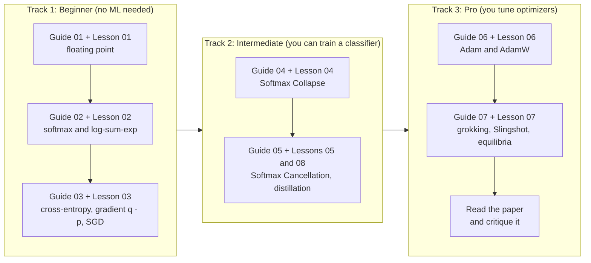

# Learning Path: from "what is a logit?" to reading the paper like a specialist

This kit accompanies the explainer [`README.md`](../README.md) for arXiv:2610.31642, *A Fix for Softmax and Cross-Entropy* (Barron, Gnanapragasam, Tschannen, 2026-10-22). The explainer tells you **what the paper says**. This kit helps you **understand it by doing**: each idea has a written guide, a runnable script that reproduces it, and exercises.

Everything runs with NumPy and Matplotlib. No GPU, PyTorch, JAX or dataset downloads are needed.

---

## 1. How the kit is organised

```
softmax-fix-teaching-kit/
├── README.md                     the paper explainer (start here for the big picture)
├── requirements.txt              numpy, matplotlib
├── docs/
│   ├── 00_learning_path.md       this file
│   ├── 01_floating_point_guide.md
│   ├── 02_softmax_and_logsumexp_guide.md
│   ├── 03_cross_entropy_and_gradients_guide.md
│   ├── 04_softmax_collapse_deep_dive.md
│   ├── 05_softmax_cancellation_deep_dive.md
│   ├── 06_optimizers_adam_guide.md
│   ├── 07_grokking_slingshot_equilibria.md
│   ├── 08_teaching_guide.md      lesson plans, misconceptions, quiz with answers
│   ├── 09_cheat_sheet.md         one-page formulas and numbers
│   └── figures/                  PNG figures written by the scripts
└── code/
    ├── softmax_fix.py            the reusable library (standard vs fixed, bf16 emulator)
    ├── optim.py                  SGD and AdamW from scratch
    ├── test_softmax_fix.py       26 assert-based checks
    ├── lesson01 ... lesson08     runnable lesson scripts with "# %%" cells
    ├── _figs.py                  figure helper
    └── run_all.py                runs everything and regenerates the figures
```

**Running the code**

```bash
pip install -r requirements.txt
cd code
python test_softmax_fix.py          # 26 checks, takes a fraction of a second
python lesson04_softmax_collapse.py # any single lesson
python run_all.py                   # everything (about 1 minute), regenerates docs/figures
```

Each lesson file contains `# %%` markers, so in VS Code, Spyder or Jupytext you can run one cell at a time and read the output before moving on. Set the environment variable `SHOW=1` to open figures in a window instead of only saving them.

---

## 2. Three tracks



| Track | You should be able to, afterwards | Guides | Lessons |
|---|---|---|---|
| **1. Beginner** | Explain floating point, softmax, cross-entropy and the gradient $\mathbf q-\mathbf p$ to a classmate, and compute them by hand for 3 classes. | 01, 02, 03 | 01, 02, 03 |
| **2. Intermediate** | Derive the precision cliff $(p+1)\ln 2$, explain both bugs with numbers, and read `fixed_cross_entropy` line by line. | 04, 05 | 04, 05, 08 |
| **3. Pro** | Explain why Adam makes tiny gradients matter, derive $m^\star\approx\log(1/\epsilon)$, say which claims of the paper this kit verifies and which it does not. | 06, 07 | 06, 07 |

Suggested pacing (planning estimates, not measured): Track 1 about 3 to 4 hours, Track 2 about 3 hours, Track 3 about 3 to 4 hours, plus time to read the paper. [`08_teaching_guide.md`](08_teaching_guide.md) has a three-session plan if you are teaching others.

---

## 3. Map between the paper, the guides and the code

| Paper section | Idea | Guide | Code |
|---|---|---|---|
| 1 Introduction (Eq. 1 to 4) | Max-shift softmax, logit margin, precision cliff | 01, 02, 04 | lessons 01, 02, 04 |
| 2 Softmax Collapse (Eq. 3 to 7) | Bug 1 and its fix | 04 | `fixed_cross_entropy`, lesson 04 |
| 3 Softmax Cancellation (Eq. 8, 9) | Bug 2 and its fix | 05 | `fixed_soft_target_grad`, lessons 05, 08 |
| 4 The Slingshot Mechanism | Why spikes appear under Adam | 06, 07 | lesson 06 (per-parameter mechanics) |
| 5 Margin Equilibria (Eq. 10, 11) | $m^\star\approx\log(1/\epsilon)$ | 07 | lesson 07 |
| 6 Grokking Across Precisions | Table 1, four benchmarks | 07 | **not reproduced** (needs Transformers) |
| 7 Soft-Target Distillation | Drift when student equals teacher | 05 | lesson 08 (toy version) |

---

## 4. What this kit verifies, and what it does not

Being clear about this is part of learning science. Every claim in the guides carries one of these tags:

| Tag | Meaning |
|---|---|
| **[derived]** | Follows from algebra shown in the guide; you can check it on paper. |
| **[verified here]** | A script in `code/` reproduces it, with the printed output quoted in the guide. |
| **[paper]** | Reported by the authors from experiments this kit does not rerun. |

In short: the precision cliff values, the single-example collapse, the single-example cancellation, the fixed formulas, and the scaling of the margin plateau with $\epsilon$ in a toy model are **[verified here]**. The grokking benchmarks, Slingshot loss spikes in Transformers and MLPs, and the numbers in the paper's Table 1 are **[paper]**.

---

## 5. Prerequisites you can pick up on the way

* **Logs and exponentials**: guide 01 and 02 recap them.
* **Derivatives and the chain rule**: guide 03 derives everything it uses.
* **Python and NumPy basics**: arrays, broadcasting, `axis=-1`. If `np.sum(x, axis=-1, keepdims=True)` is unfamiliar, run lesson 02 first.
* **No linear algebra beyond matrix multiplication** is assumed.

If a symbol is unclear, check the glossary at the end of the main README and the cheat sheet in [`09_cheat_sheet.md`](09_cheat_sheet.md).
