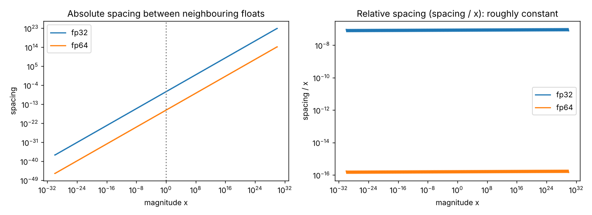

# Guide 01: Floating Point, the Ground the Whole Paper Stands On

**Companion script:** [`code/lesson01_floating_point.py`](../code/lesson01_floating_point.py)
**Level:** beginner. **Prerequisites:** none.

Both bugs in the paper are *floating-point* bugs. The formulas are correct on paper; the arithmetic of real computers is what breaks them. If you understand this guide, the paper's central mechanism will feel obvious.

---

## 1. Real numbers do not fit in a computer

A computer stores a number in a fixed number of bits, so it can only represent a **finite set** of real numbers. Everything else is rounded to a nearby representable number.

You know this from decimals: $1/3 = 0.3333\ldots$ cannot be written exactly with finitely many digits. Computers use **binary**, and $0.1$ in binary is also an infinite repeating pattern:

$$0.1_{10} = 0.0001\,1001\,1001\,1001\ldots_2$$

So the stored value of `0.1` is slightly off, and `0.1 + 0.2` gives `0.30000000000000004`. That is not a Python bug; it is how every language behaves.

---

## 2. The format: sign, exponent, fraction

Floating point is scientific notation in base 2:

$$x = (-1)^{s}\times 1.f_1f_2\ldots f_p\;\times 2^{e}$$

* $s$: one **sign** bit.
* $e$: the **exponent**, which sets the *range* (how big or small).
* $f_1\ldots f_p$: the **fraction** (also called mantissa or significand), which sets the *precision* (how many significant digits).

```
 fp32 (32 bits)
 +------+--------------+-------------------------------+
 | sign | exponent (8) | fraction (23 bits, p = 23)    |
 +------+--------------+-------------------------------+

 bf16 (16 bits)          fp16 (16 bits)         fp64 (64 bits)
 1 | 8 exp | 7 frac      1 | 5 exp | 10 frac     1 | 11 exp | 52 frac
```

| Format | Fraction bits $p$ | Spacing at 1.0 ($2^{-p}$) | Largest value | Smallest normal value |
|---|---|---|---|---|
| bf16 | 7 | $7.8\times10^{-3}$ | about $3.4\times10^{38}$ | about $1.2\times10^{-38}$ |
| fp16 | 10 | $9.8\times10^{-4}$ | 65504 | about $6.1\times10^{-5}$ |
| fp32 | 23 | $1.19\times10^{-7}$ | about $3.4\times10^{38}$ | about $1.2\times10^{-38}$ |
| fp64 | 52 | $2.2\times10^{-16}$ | about $1.8\times10^{308}$ | about $2.2\times10^{-308}$ |

Notice bf16: it has the **same range as fp32** (same 8 exponent bits) but only **7 bits of precision**. It is popular for neural-network training because range matters more than precision for most activations. For this paper that precision is exactly the problem.

**Two different limits.** Keep these separate:

| Limit | Controlled by | Failure | Example |
|---|---|---|---|
| Range | exponent bits | overflow to `inf`, underflow to `0` | $e^{89}$ in fp32 is `inf` |
| Precision | fraction bits | rounding, absorption, cancellation | $1+10^{-8}$ in fp32 is `1.0` |

Softmax code is carefully protected against the first (subtract the max). The paper is about the second.

---

## 3. Spacing is relative: the key picture

Between $2^{k}$ and $2^{k+1}$ there are always exactly $2^{p}$ representable numbers, evenly spaced. So the gap between neighbours is $2^{k-p}$: **proportional to the size of the number**.



*Left: absolute spacing grows with magnitude. Right: relative spacing (spacing divided by the number) is roughly constant at about $10^{-7}$ for fp32 and $10^{-16}$ for fp64.*

Measured in `lesson01_floating_point.py` for fp32:

| Near | Spacing between neighbours | Relative |
|---|---|---|
| $10^{-30}$ | $9.4\times10^{-38}$ | $9.4\times10^{-8}$ |
| $10^{-3}$ | $1.2\times10^{-10}$ | $1.2\times10^{-7}$ |
| $1$ | $1.2\times10^{-7}$ | $1.2\times10^{-7}$ |
| $10^{3}$ | $6.1\times10^{-5}$ | $6.1\times10^{-8}$ |
| $10^{10}$ | $1.0\times10^{3}$ | $1.0\times10^{-7}$ |

**Consequence.** Floating point is extremely fine near 0 and coarse near 1 (in absolute terms). A value like $10^{-20}$ is stored accurately, but $1+10^{-20}$ cannot be stored: the nearest representable number is $1$.

---

## 4. Rounding and absorption

Results of arithmetic are **rounded to the nearest representable number**. If exactly halfway between two, the one with an even last bit is chosen ("ties to even").

Near $1$ the spacing is $2^{-p}$, so the halfway point is $2^{-(p+1)}$. Therefore:

$$1 + x \;=\; 1 \quad\text{in floating point whenever}\quad 0\le x\le 2^{-(p+1)}$$

This is **absorption**: the small number vanishes. Verified in `lesson01_floating_point.py`: for fp16, fp32 and fp64, $1+2^{-(p+1)}$ evaluates to exactly 1.0 (the tie rounds to even, which is 1.0), while a number just above $2^{-(p+1)}$ rounds up to $1+2^{-p}$.

| Format | Half-spacing $2^{-(p+1)}$ | Anything below this is absorbed by $1.0$ |
|---|---|---|
| bf16 | $3.9\times10^{-3}$ | yes |
| fp32 | $6.0\times10^{-8}$ | yes |
| fp64 | $1.1\times10^{-16}$ | yes |

### From absorption to the paper's "precision cliff"

In softmax, the denominator is $1+e^{-m}$ ($m$ = logit margin). It is absorbed to $1.0$ when

$$e^{-m}\le 2^{-(p+1)}\iff m\ge (p+1)\ln 2 .$$

| Format | $p$ | Cliff $(p+1)\ln 2$ | Paper |
|---|---|---|---|
| bf16 | 7 | 5.55 | 5.5 |
| fp16 | 10 | 7.62 | (not in paper) |
| fp32 | 23 | 16.64 | 16.6 |
| fp64 | 52 | 36.74 | 36.7 |

**[derived]** and **[verified here]**: lesson 04 finds the exact first margin at which the standard gradient becomes zero and gets 5.55, 16.64 and 36.74.

---

## 5. Catastrophic cancellation

Subtracting two nearly equal numbers cancels the leading digits that agree and leaves only the digits that were already contaminated by rounding error.

```
  0.6652410      stored with error up to 0.0000001
- 0.6652409      stored with error up to 0.0000001
-----------
  0.0000001      the true difference could be anywhere from 0 to 0.0000003
```

Relative error of the result can be 100% even though each input was accurate to 7 digits. This is Bug 2 of the paper: it subtracts $p_k$ from $q_k$ when both are nearly equal.

---

## 6. Overflow, underflow and subnormals

* **Overflow:** results larger than the maximum become `inf`. In fp32, $e^{89}=\texttt{inf}$ (lesson 01 prints this).
* **Underflow:** results smaller than the smallest normal number lose precision gradually ("subnormals") and finally become exactly `0`. In fp32, $e^{-104}=0.0$.
* The classic cure for softmax overflow is to subtract the maximum logit first, which turns every exponent into a number $\le 0$.

---

## 7. The standard cures: `log1p`, `expm1`, and why they work

If you need $\log(1+x)$ for tiny $x$, never form $1+x$:

| Want | Naive (loses digits) | Accurate |
|---|---|---|
| $\log(1+x)$ | `np.log(1 + x)` | `np.log1p(x)` |
| $e^{x}-1$ | `np.exp(x) - 1` | `np.expm1(x)` |

The accurate versions use series or correction terms internally so that tiny $x$ is never added to $1$. Verified in the lesson 01 output (float64):

| $x$ | `log(1+x)` | `log1p(x)` |
|---|---|---|
| $10^{-12}$ | $1.0001\times10^{-12}$ | $1.0000\times10^{-12}$ |
| $10^{-16}$ | $0$ | $1.0\times10^{-16}$ |
| $10^{-20}$ | $0$ | $1.0\times10^{-20}$ |

The paper's fixes are built from exactly these tools plus `softplus`.

---

## 8. Rules of thumb you can reuse

1. **Never rely on `1 + tiny` keeping the tiny part.** Rewrite so that the tiny quantity stays in a numerator, or use `log1p` / `expm1`.
2. **Avoid subtracting nearly equal numbers** when the difference is what you need. Compute the difference directly from the underlying quantities.
3. **Compare floats with a tolerance**, never `==`, except when exactness is guaranteed by construction (as with the paper's "exactly 0").
4. **Order of operations matters:** $(a+b)+c\neq a+(b+c)$ in general.
5. **Know your format's cliff.** In bf16 many "confident" quantities saturate at margin about 5.5.
6. **Test in float64 as a reference**, then compare lower precision against it. Every lesson script in this kit does this.

---

## 9. Exercises

1. Predict: `np.float32(1) + np.float32(1e-8) == np.float32(1)`. Then check. (Answer: `True`, because $10^{-8}<6.0\times10^{-8}$.)
2. Write a loop that halves `x` until `np.float32(1) + x == 1` and report the last `x` that still changed the sum. Compare with $2^{-23}$.
3. Compute `np.float32(16777216) + np.float32(1)`. Why is it unchanged? (Hint: $2^{24}=16777216$ and the spacing there is 2.)
4. Show that $(1+10^{-16}) - 1$ evaluates to `0.0` in float64 but `np.expm1(1e-16)` gives $10^{-16}$.
5. For bf16, compute the spacing at 128. (Hint: spacing is $2^{7-7}=1$.)

<details><summary>Answers to 2, 3 and 5</summary>

2. Run on this kit's machine: the last `x` that changed the sum is $2^{-23}=1.19\times10^{-7}$ (the spacing at 1), and the first `x` that did not is $2^{-24}=5.96\times10^{-8}$. That is the exact tie point from section 4: $1+2^{-24}$ is halfway between $1$ and $1+2^{-23}$ and rounds to even, which is $1$.
3. Spacing of fp32 numbers in $[2^{24},2^{25})$ is $2^{24-23}=2$, so adding 1 is a tie and rounds to even, which is $2^{24}$ again.
5. $128=2^{7}$, with 7 fraction bits the spacing is $2^{7-7}=1$.
</details>

---

## 10. What to carry into the next guide

* Floating point has **fixed relative precision**, so absolute precision is poor near 1 and excellent near 0.
* "$1+\text{tiny}=1$" is the single most important fact for Softmax Collapse.
* "$\text{big}-\text{big}$ loses digits" is the single most important fact for Softmax Cancellation.

Next: [Guide 02: Softmax and log-sum-exp](02_softmax_and_logsumexp_guide.md).
