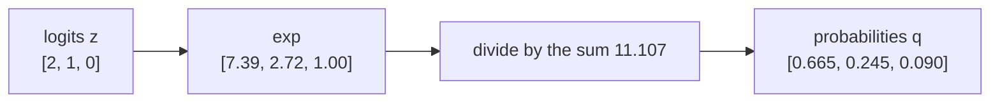
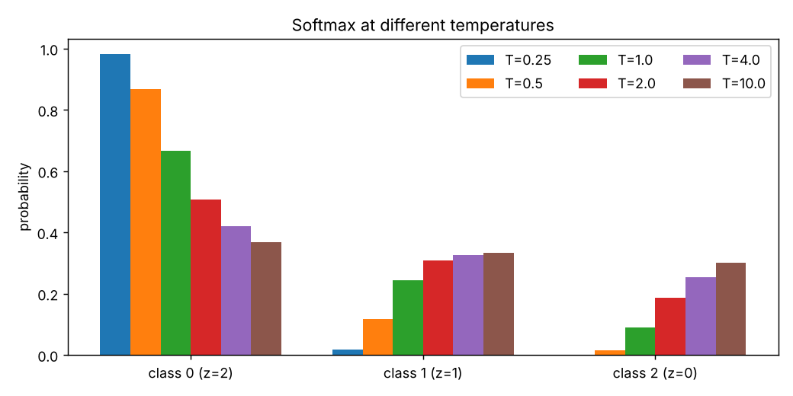
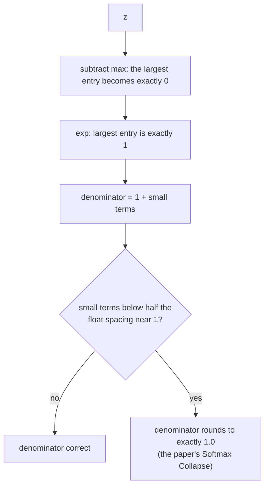

# Guide 02: Softmax, Log-Sum-Exp and the Max-Shift Trick

**Companion script:** [`code/lesson02_softmax_from_scratch.py`](../code/lesson02_softmax_from_scratch.py)
**Level:** beginner. **Prerequisites:** [Guide 01](01_floating_point_guide.md) (only the idea of overflow).

---

## 1. The problem softmax solves

A classifier's last layer outputs one real number per class, called a **logit**:

$$\mathbf z=[z_1,\ldots,z_K]\in\mathbb R^K .$$

Logits can be negative or huge and do not add up to anything meaningful. We want **probabilities**: non-negative numbers that sum to 1. Softmax does that:

$$q_k=\mathrm{softmax}(\mathbf z)_k=\frac{e^{z_k}}{\sum_{j=1}^{K}e^{z_j}} .$$

Worked example, $\mathbf z=[2,1,0]$:

| Step | Class 0 | Class 1 | Class 2 |
|---|---|---|---|
| logit $z_k$ | 2 | 1 | 0 |
| $e^{z_k}$ | 7.389 | 2.718 | 1.000 |
| sum of the row above | 11.107 | | |
| $q_k=e^{z_k}/11.107$ | 0.665 | 0.245 | 0.090 |

(Printed by `lesson02_softmax_from_scratch.py`.) Think of $e^{z_k}$ as the "votes" for class $k$ and $q_k$ as its share of the vote.

---

## 2. Properties worth proving once

Each of these is used somewhere in the paper.

**P1. Positivity and normalisation.** $e^{z}>0$, and dividing by the sum makes the entries add to 1. So $\mathbf q$ is a valid probability distribution.

**P2. Order preserving.** $z_a>z_b\Rightarrow q_a>q_b$, because $e^{x}$ is increasing. The arg-max of the logits is the arg-max of the probabilities.

**P3. Shift invariance.** For any constant $c$,
$$\frac{e^{z_k+c}}{\sum_j e^{z_j+c}}=\frac{e^{c}e^{z_k}}{e^{c}\sum_j e^{z_j}}=q_k .$$
Only **differences** between logits matter. Verified in lesson 02: shifting $[2,1,0]$ by $-5$, $0$ or $+100$ gives identical output. Consequence: logits have one redundant degree of freedom.

**P4. Two classes is the sigmoid.** With $K=2$,
$$q_0=\frac{1}{1+e^{-(z_0-z_1)}}=\sigma(z_0-z_1).$$
Softmax generalises the logistic sigmoid. This is also where the paper's $q_t=1/(1+e^{-m})$ comes from.

**P5. Temperature.** Dividing logits by $T>0$ before softmax controls sharpness:

* $T\to0$: probabilities approach one-hot on the arg-max.
* $T=1$: ordinary softmax.
* $T\to\infty$: probabilities approach uniform $1/K$.

Printed in lesson 02 for $\mathbf z=[2,1,0]$: $T=0.25$ gives $[0.982,0.018,0.0003]$, $T=1$ gives $[0.665,0.245,0.090]$, $T=10$ gives $[0.367,0.332,0.301]$. Temperature is the central tool of distillation (Guide 05).

---

## 3. Log-sum-exp: a smooth maximum

Define

$$\mathrm{LSE}(\mathbf z)=\log\sum_{j}e^{z_j}.$$

**Bounds.** Let $z_{\max}=\max_j z_j$. Then
$$z_{\max}\le\mathrm{LSE}(\mathbf z)\le z_{\max}+\log K .$$
*Proof.* The sum contains the term $e^{z_{\max}}$ and has at most $K$ terms each $\le e^{z_{\max}}$, so $e^{z_{\max}}\le\sum_j e^{z_j}\le K e^{z_{\max}}$. Take logs. $\square$

So LSE is a differentiable stand-in for max. Even better, **softmax is its gradient**:

$$\frac{\partial\mathrm{LSE}}{\partial z_j}=\frac{e^{z_j}}{\sum_i e^{z_i}}=q_j .$$

This identity is the key step in deriving the cross-entropy gradient (Guide 03).

**Log-softmax** is the log of the softmax, and it simplifies:

$$\log q_k=z_k-\mathrm{LSE}(\mathbf z).$$

Lesson 02 confirms for $\mathbf z=[2,1,0]$: $\mathrm{LSE}=2.4076$ and $\log q=[-0.4076,-1.4076,-2.4076]$.

---

## 4. Numerical problems and the max-shift trick

### 4.1 Overflow

$e^{1000}$ is `inf` in float64 (and $e^{89}$ already in float32). Naive softmax of $[1000,1001,1002]$ computes $\texttt{inf}/\texttt{inf}=\texttt{nan}$. Lesson 02 prints exactly that.

**Fix (standard in every library):** subtract the maximum first. By P3 the result is unchanged, and all exponents are now $\le0$:

$$\tilde z_k=z_k-z_{\max},\qquad q_k=\frac{e^{\tilde z_k}}{\sum_j e^{\tilde z_j}} .$$

The stable softmax of $[1000,1001,1002]$ is $[0.090,0.245,0.665]$.

The same shift gives a stable log-sum-exp:
$$\mathrm{LSE}(\mathbf z)=z_{\max}+\log\sum_j e^{z_j-z_{\max}} .$$

### 4.2 Underflow, and why log-softmax is its own function

In float32, $e^{-200}$ underflows to $0$. So $\log(\mathrm{softmax}(\mathbf z))$ of $[0,-200]$ returns $[0,-\infty]$, while the direct $z_k-\mathrm{LSE}(\mathbf z)$ correctly returns $[0,-200]$. (Lesson 02 shows both.) Libraries therefore never compute `log(softmax(z))`; they compute log-softmax directly.

### 4.3 The "1" in the denominator, a set-up for the paper

After subtracting the maximum, the largest entry becomes $\tilde z_{\max}=0$, so its exponential is exactly $1$. The denominator is therefore

$$\underbrace{1}_{\text{from the max}}+\underbrace{\sum_{j\ne\max}e^{\tilde z_j}}_{\text{small positive}}.$$

This design has two good properties: no overflow, and the denominator is at least $1$ (no division by zero). **It also plants a time bomb**: for a confident model the small sum is far below the spacing of floats near 1, so the denominator becomes exactly $1.0$. Lesson 02 shows it for $[9,-9,-9]$: after shifting the exponentials are $[1,\,1.5\times10^{-8},\,1.5\times10^{-8}]$ and the float32 sum is `1.0`. Guide 04 turns this into the first bug.

---

## 5. The Jacobian (what the gradient of softmax looks like)

For $\mathbf q=\mathrm{softmax}(\mathbf z)$:

$$\frac{\partial q_k}{\partial z_j}=q_k(\delta_{kj}-q_j),\qquad J=\mathrm{diag}(\mathbf q)-\mathbf q\mathbf q^{\top}.$$

Here $\delta_{kj}$ is 1 if $k=j$ and 0 otherwise. Row sums of $J$ are zero: $J\mathbf 1=\mathbf q-\mathbf q(\mathbf q^{\top}\mathbf 1)=\mathbf 0$. This is P3 again: moving all logits together changes nothing. Lesson 03 prints `J @ ones = [0, 0, 0, 0, 0]`.

---

## 6. Common misconceptions

| Misconception | Reality |
|---|---|
| "Softmax outputs are the model's confidence in a calibrated, real-world sense." | They are normalised scores. Calibration (do 90% predictions turn out right 90% of the time?) must be checked separately and is often poor. |
| "Larger logits always mean more confidence." | Only **differences** matter (P3). Adding 100 to every logit changes nothing. |
| "Softmax is a hard arg-max." | It is a soft arg-max; hardness is controlled by temperature. |
| "Subtracting the max changes the answer." | Mathematically it does not (P3). Numerically it prevents overflow but leaves precision problems that the paper addresses. |
| "$\log(\mathrm{softmax}(z))$ is fine to compute." | It underflows. Use log-softmax. |

---

## 7. Exercises

1. Compute $\mathrm{softmax}([0,0,0,0])$ and $\mathrm{softmax}([1000,0,0])$ by reasoning, then check with `std_softmax`.
2. Prove P4: $\mathrm{softmax}([a,b])=[\sigma(a-b),\sigma(b-a)]$.
3. For $K=5$, what is the largest possible gap between $\mathrm{LSE}(\mathbf z)$ and $z_{\max}$? When is it attained?
4. Show that $\sum_k q_k(\delta_{kj}-q_j)=0$ for every $j$.
5. Using `softmax_fix.lse`, compute $\mathrm{LSE}([1000,1000])$ and compare to the naive formula.

Answers

1. Uniform $[0.25]\times4$; and $[1,0,0]$ to many digits (the other two entries are $e^{-1000}$, which underflow to 0 in float64).
2. $\dfrac{e^a}{e^a+e^b}=\dfrac{1}{1+e^{b-a}}=\sigma(a-b)$.
3. $\log 5$, attained when all five logits are equal.
4. $\sum_k q_k\delta_{kj}=q_j$ and $\sum_k q_kq_j=q_j$, so the difference is $0$.
5. $1000+\log2\approx1000.693$. The naive formula gives `inf` and then `inf`.

---

## 8. What to carry into the next guide

* Softmax depends only on logit **differences**.
* LSE is a smooth max, and its gradient is softmax.
* The standard stable implementation hides a literal `1.0` in the denominator. Remember where it is.

Next: [Guide 03: Cross-entropy and gradients](03_cross_entropy_and_gradients_guide.md).
