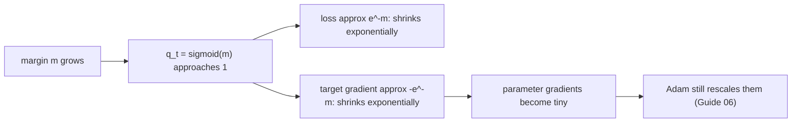
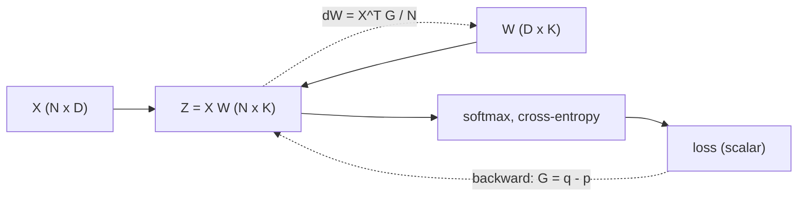
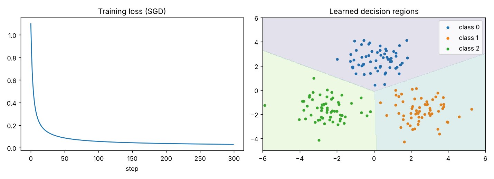

# Guide 03: Cross-Entropy, the Gradient $\mathbf q-\mathbf p$, and Backpropagation into a Layer

**Companion script:** [`code/lesson03_gradients_and_sgd.py`](../code/lesson03_gradients_and_sgd.py)
**Level:** beginner to intermediate. **Prerequisites:** [Guide 02](02_softmax_and_logsumexp_guide.md).

---

## 1. Why a loss function at all?

Training means adjusting parameters so that predictions get better. To say "better" numerically we need a **loss**: a single number that is small when the model is right and large when it is wrong. For classification with softmax outputs, the standard loss is **cross-entropy**.

---

## 2. Surprise, entropy, cross-entropy and KL divergence

### 2.1 Surprise
If an event has probability $q$, the **surprise** of seeing it is $-\log q$. Certain events ($q=1$) have surprise 0; rare events have large surprise.

| $q_t$ (probability the model gave the true class) | surprise $-\log q_t$ |
|---|---|
| 0.99 | 0.010 |
| 0.9 | 0.105 |
| 0.5 | 0.693 |
| 0.1 | 2.303 |
| 0.01 | 4.605 |

(Printed by lesson 03.)

### 2.2 Entropy
For a distribution $\mathbf p$, **entropy** is the average surprise under $\mathbf p$ itself:
$$H(\mathbf p)=-\sum_k p_k\log p_k .$$
A fair coin has $H=\log 2=0.693$; a one-hot distribution has $H=0$.

### 2.3 Cross-entropy
**Cross-entropy** of model $\mathbf q$ relative to target $\mathbf p$ is the average surprise the *model* feels when outcomes are drawn from $\mathbf p$:
$$H(\mathbf p,\mathbf q)=-\sum_k p_k\log q_k .$$
This is the paper's $\mathcal L(\mathbf z,\mathbf p)=-\sum_k p_k\mathrm{logsoftmax}(\mathbf z)_k$ with $\mathbf q=\mathrm{softmax}(\mathbf z)$.

* **Hard target** (true class $t$, so $\mathbf p$ is one-hot): the sum has a single term, $\mathcal L=-\log q_t=-z_t+\mathrm{LSE}(\mathbf z)$.
* **Soft target** (e.g. a teacher's distribution): all terms count.

### 2.4 KL divergence
$$\mathrm{KL}(\mathbf p\,\|\,\mathbf q)=\sum_k p_k\log\frac{p_k}{q_k}=H(\mathbf p,\mathbf q)-H(\mathbf p).$$
It is always $\ge0$ and equals $0$ only when $\mathbf p=\mathbf q$.
*Proof of $\ge0$:* by Jensen's inequality for the concave $\log$,
$-\mathrm{KL}=\sum_k p_k\log\frac{q_k}{p_k}\le\log\sum_k p_k\frac{q_k}{p_k}=\log\sum_k q_k\le\log1=0$. $\square$

Because $H(\mathbf p)$ does not depend on the student, **minimising cross-entropy against a fixed teacher is the same as minimising KL**, and their gradients with respect to the student's logits are identical. This is why the paper says "KL regularization" and "soft-target cross-entropy" interchangeably.

### 2.5 Maximum-likelihood view
Averaging $-\log q_{t_i}$ over a dataset and minimising it is the same as **maximising the likelihood** of the observed labels under the model. Cross-entropy is not an arbitrary choice; it is the negative log-likelihood of a categorical model.

---

## 3. The gradient of softmax cross-entropy

We want $\partial\mathcal L/\partial z_j$ for $\mathcal L=-\sum_k p_k\log q_k$ with $\sum_kp_k=1$.

**Step 1.** Use $\log q_k=z_k-\mathrm{LSE}(\mathbf z)$:
$$\mathcal L=-\sum_kp_kz_k+\mathrm{LSE}(\mathbf z)\sum_kp_k=-\sum_kp_kz_k+\mathrm{LSE}(\mathbf z).$$

**Step 2.** Differentiate each term:
$$\frac{\partial}{\partial z_j}\Big(-\sum_kp_kz_k\Big)=-p_j,\qquad\frac{\partial\mathrm{LSE}}{\partial z_j}=q_j .$$

**Result:**
$$\boxed{\;g_j=\frac{\partial\mathcal L}{\partial z_j}=q_j-p_j\;}$$

"Predicted probability minus target probability." Lesson 03 checks this against finite differences: analytic and numeric gradients agree to $1.8\times10^{-10}$.

### 3.1 The gradient sums to zero

$$\sum_jg_j=\sum_jq_j-\sum_jp_j=1-1=0 .$$

Intuition: adding a constant to every logit changes nothing (Guide 02, P3), so the loss has no slope in the direction $(1,\ldots,1)$, which is exactly the sum of the partial derivatives. **Zero-sum is a correctness test** for any implementation. The paper's two bugs both break it (Guide 04 and 05).

### 3.2 Hard-target gradient and the margin

For a hard target $t$:
$$g_t=q_t-1\le0,\qquad g_j=q_j\ge0\ (j\ne t).$$

Write the **logit margin**
$$m=z_t-\log\sum_{j\ne t}e^{z_j}.$$
Then $q_t=\dfrac{e^{z_t}}{e^{z_t}+\sum_{j\ne t}e^{z_j}}=\dfrac{1}{1+e^{-m}}=\sigma(m)$ and

$$\mathcal L=\log(1+e^{-m}),\qquad g_t=-\frac{e^{-m}}{1+e^{-m}}.$$

For a confident model ($m$ large): $\mathcal L\approx e^{-m}$ and $g_t\approx-e^{-m}$. **Each unit of margin shrinks the gradient by a factor $e\approx2.72$.**

Lesson 03 trains a small model and confirms this. Continuing training past the first 300 steps, after 2000 further steps the median margin is 9.43 with median $|g_t|=8.05\times10^{-5}$, and $e^{-9.43}=8.05\times10^{-5}$; after a further 8000 steps (10,000 in total) the median margin is 13.48 and $|g_t|=1.40\times10^{-6}=e^{-13.48}$. **[verified here]**

---

## 4. From logits to parameters: backpropagation through a linear layer

Take a one-layer classifier. Inputs $X\in\mathbb R^{N\times D}$ ($N$ examples, $D$ features), weights $W\in\mathbb R^{D\times K}$.

$$Z=XW\in\mathbb R^{N\times K},\qquad \mathcal L=\frac1N\sum_{i=1}^N\ell(\mathbf z_i,t_i).$$

Let $G\in\mathbb R^{N\times K}$ hold the per-example logit gradients: row $i$ is $\mathbf q_i-\mathbf p_i$. By the chain rule,
$$\frac{\partial\mathcal L}{\partial Z}=\frac1N G,\qquad\frac{\partial\mathcal L}{\partial W}=X^{\top}\Big(\frac1N G\Big)\in\mathbb R^{D\times K}.$$

Dimension check: $X^\top$ is $D\times N$, $G$ is $N\times K$, product is $D\times K$, the shape of $W$. This is exactly the line `W -= lr * (X.T @ G) / len(X)` in lesson 03.

**Why this matters for the paper.** Everything downstream of the logits (every weight update, every Adam moment) receives its information through $G$. If $G$ is wrong in the last few bits, so is everything else. That is why a bug in the 10 lines of softmax cross-entropy can alter whole training runs.

---

## 5. A complete tiny training run

Lesson 03 trains softmax regression on three 2-D blobs with plain SGD (learning rate 0.1, 300 steps, 180 points):

| Step | Loss | Accuracy |
|---|---|---|
| 0 | 1.0986 ($=\ln3$, uniform prediction) | 0.333 |
| 299 | 0.0299 | 1.000 |

The initial loss $\ln3=1.0986$ is a useful sanity check: with all-zero weights the model predicts uniformly, so the loss must equal $\ln K$.

---

## 6. Common misconceptions

| Misconception | Reality |
|---|---|
| "Cross-entropy and KL are different losses." | For a fixed target they differ by the constant $H(\mathbf p)$; same gradients. |
| "The loss going to 0 means the model is perfect." | It means it is extremely confident on training data. It may be overfit. (This is the grokking setting, Guide 07.) |
| "Gradient = $-\log q_t$." | The loss is $-\log q_t$; the gradient with respect to logits is $q-p$. |
| "A tiny gradient means tiny parameter changes." | True for SGD, false for Adam (Guide 06). |

---

## 7. Exercises

1. Compute by hand the loss and gradient for $\mathbf z=[2,1,0]$ and target $t=0$. Check with `std_cross_entropy`.
2. Derive $g_j=q_j-p_j$ without looking, starting from $\mathcal L=-\sum_kp_k(z_k-\mathrm{LSE}(\mathbf z))$.
3. Show that for $K=2$ the loss is $\log(1+e^{-m})$ with $m=z_t-z_{1-t}$ (the logistic loss).
4. In lesson 03, set `lr = 1.0`. What happens to the loss curve and why?
5. Add L2 weight decay to the lesson 03 loop (`W -= lr * wd * W`) and watch the margin plateau.

Answers to 1 and 3

1. $q=[0.665,0.245,0.090]$, loss $=-\ln0.665=0.4076$, gradient $=[0.665-1,\,0.245,\,0.090]=[-0.335,0.245,0.090]$ (sums to 0).
3. With $K=2$ the only wrong class is $1-t$, so $m=z_t-\log e^{z_{1-t}}=z_t-z_{1-t}$ and $q_t=\sigma(m)$, hence $-\log q_t=\log(1+e^{-m})$.

---

## 8. What to carry into the next guide

* Gradient of softmax cross-entropy with respect to logits is $\mathbf q-\mathbf p$, and it **must sum to zero**.
* For a hard target it is controlled by the margin: $g_t=-e^{-m}/(1+e^{-m})$.
* Everything above the logits inherits any error in this vector.

Next: [Guide 04: Softmax Collapse, the first bug](04_softmax_collapse_deep_dive.md).
