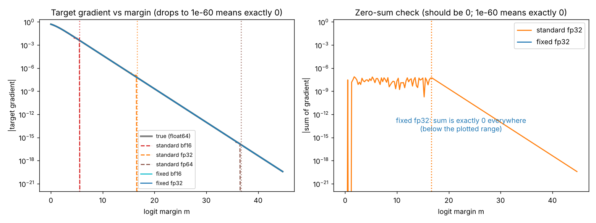

# Guide 04: Bug 1, Softmax Collapse (and its fix), in Depth

**Companion scripts:** [`code/lesson04_softmax_collapse.py`](../code/lesson04_softmax_collapse.py), [`code/check_my_framework.py`](../code/check_my_framework.py), library [`code/softmax_fix.py`](../code/softmax_fix.py)
**Paper:** Sections 1 and 2 (Equations 1 to 7). **Level:** intermediate. **Prerequisites:** Guides 01 to 03.

---

## 1. The claim in one paragraph

When a model is confident and correct, the standard softmax cross-entropy code computes a target-class gradient of exactly **0.0**, while the gradients of the wrong classes stay positive. The gradient vector then does not sum to zero, which a correct gradient must. The cause is a floating-point absorption of $e^{-m}$ into $1.0$ once the logit margin $m$ exceeds the **precision cliff** $c=(p+1)\ln2$ (about 5.5 in bf16, 16.6 in fp32, 36.7 in fp64). The fix rewrites the computation so that $e^{-m}$ is never added to $1$.

---

## 2. Setting and notation

* Logits $\mathbf z\in\mathbb R^K$, hard target $t$, and suppose $z_t=z_{\max}$ (the model is right).
* Margin $m=z_t-\log\sum_{j\ne t}e^{z_j}$ (Guide 03).
* True quantities (Guide 03): $q_t=\dfrac1{1+e^{-m}}$, $\ \mathcal L=\log(1+e^{-m})$, $\ g_t=-\dfrac{e^{-m}}{1+e^{-m}}$, $\ g_j=\dfrac{e^{z_j-z_t}}{1+e^{-m}}$.

---

## 3. Following the standard algorithm, number by number

Use the paper's example $\mathbf z=[9,-9,-9]$, $t=0$, in **float32**. Everything below is printed by `lesson04_softmax_collapse.py` and `check_my_framework.py`.

| Step | Mathematics | float32 value |
|---|---|---|
| 1. shift by max | $\tilde{\mathbf z}=\mathbf z-9$ | $[0,\,-18,\,-18]$ |
| 2. exponentiate | $e^{\tilde z_k}$ | $[1,\ 1.523\times10^{-8},\ 1.523\times10^{-8}]$ |
| 3. denominator | $1+1.523\times10^{-8}+1.523\times10^{-8}$ | **`1.0`** (exactly) |
| 4. probabilities | $q_k$ | $[1,\ 1.523\times10^{-8},\ 1.523\times10^{-8}]$ |
| 5. loss | $-\log q_0$ | **`0.0`** (true value $3.046\times10^{-8}$) |
| 6. gradient | $\mathbf q-\mathbf e_0$ | $[\,\mathbf{0.0},\ 1.523\times10^{-8},\ 1.523\times10^{-8}]$ |
| 7. gradient sum | | $3.046\times10^{-8}$ (**should be 0**) |

Why step 3? fp32 spacing near 1 is $1.19\times10^{-7}$, so half-spacing is $5.96\times10^{-8}$. The two small terms total $3.05\times10^{-8}$, which is *below* half-spacing: absorbed. (Guide 01, section 4.)

The margin here is $m=18-\ln2=17.307>c_{32}=16.64$, so the example sits beyond the cliff. **[verified here]**

---

## 4. Why only the target gradient dies

Look at how each entry is computed in the backward pass (the standard $\tilde g_k=q_k-p_k$):

* **Target entry:** $\tilde g_t=q_t-1$. With the denominator at $1.0$, $q_t=1/1=1$, and $1-1=0$. The information "$q_t$ is $1-3\times10^{-8}$" was destroyed *before* the subtraction. This is cancellation after absorption.
* **Wrong-class entries:** $\tilde g_j=q_j=\dfrac{e^{z_j-z_t}}{\text{denominator}}$. The numerator is a tiny number that is stored exactly (floating point is fine near 0), and the denominator is $1.0$. The result is $1.523\times10^{-8}$, essentially correct.

So the entries are not equally affected:

$$\tilde g_k=\mathbf 1[k\ne t]\,g_k,\qquad\sum_k\tilde g_k=-g_t=\frac{e^{-m}}{1+e^{-m}}>0 .$$



*Left: true target gradient (grey) and the standard implementations falling to exactly zero at the three cliffs (dotted vertical lines: bf16 5.55, fp32 16.64, fp64 36.74). The fixed implementations (blue, cyan) follow the truth. Right: the sum of gradient entries, which must be zero; standard fp32 is non-zero and its error is equal to the missing $e^{-m}$ beyond the cliff.*

The same thing happens in **standalone softmax**: the backward pass rounds $q_{i_{\max}}$ to $1$, so the gradient at the arg-max becomes $0$ while the others stay positive.

---

## 5. The cliff: where it is and why

Derivation (Guide 01): $1+e^{-m}$ rounds to $1$ iff $e^{-m}\le2^{-(p+1)}$, i.e. $m\ge(p+1)\ln2$.

Lesson 04 scans margins in steps of 0.01 and reports the **first margin at which the standard target gradient is exactly zero**:

| Format | Measured | Formula $(p+1)\ln2$ | Paper |
|---|---|---|---|
| bf16 (emulated with `to_bf16`) | 5.55 | 5.55 | 5.5 |
| fp32 | 16.64 | 16.64 | 16.6 |
| fp64 | 36.74 | 36.74 | 36.7 |

**[derived]** and **[verified here]**.

**[paper]** The wrong-class gradients survive until underflow, about $m\approx88$ in fp32. That limit comes from the exponent range, not from precision.

---

## 6. The fix, derived

**Goal:** compute the target gradient without ever forming $1+e^{-m}$.

**Step 1: compute the margin separately.** Use log-sum-exp over the *other* classes:
$$m=-\mathrm{LSE}_{j\ne t}(z_j-z_t).$$
This is accurate for any size of $m$, because it is built from differences and log-sum-exp of numbers $\le0$ (Guide 02).

**Step 2: write the loss as a softplus of $-m$.**
$$\mathcal L=\log(1+e^{-m})=\mathrm{softplus}(-m).$$
A stable softplus is $\mathrm{softplus}(x)=\max(x,0)+\mathrm{log1p}(e^{-|x|})$, which never forms $1+\text{tiny}$ directly (it uses `log1p`).

**Step 3: let the derivative keep $e^{-m}$ in the numerator.**
$$\frac{d}{dm}\mathrm{softplus}(-m)=-\sigma(-m)=-\frac{e^{-m}}{1+e^{-m}} .$$
Even if the denominator $1+e^{-m}$ rounds to $1.0$, the numerator $e^{-m}$ is still there, so $g_t\approx-e^{-m}$ survives down to underflow.

**Step 4: make the gradient zero-sum automatically.** The target logit enters the loss **only through the differences $z_j-z_t$**. Any function of differences is unchanged when all logits shift, so its gradient sums to zero, and in particular
$$g_t=-\sum_{j\ne t}g_j,\qquad g_j=e^{z_j-z_t-\mathcal L}\ (j\ne t).$$
(Because $\partial\mathcal L/\partial(z_j-z_t)=\dfrac{e^{z_j-z_t}}{1+e^{-m}}$ and $e^{-\mathcal L}=\dfrac1{1+e^{-m}}$.)

For log-softmax and softmax (not just hard-target loss) the same idea is used with the arg-max slot. The arg-max entry is set to the constant $0$ (not to $z_{\max}-z_{\max}$), so $z_{\max}$ enters only through differences (paper Equation 5):
$$\tilde z_k=\mathbf 1[k\ne i_{\max}](z_k-z_{i_{\max}}),\qquad m=-\mathrm{LSE}_{j\ne i_{\max}}\tilde z_j,\qquad\mathrm{logsoftmax}(\mathbf z)_k=\tilde z_k-\mathrm{softplus}(-m).$$

---

## 7. Reading the code, line by line

From [`code/softmax_fix.py`](../code/softmax_fix.py):

```python
def fixed_cross_entropy(z, t):
    K = z.shape[-1]
    z_t = _take_target(z, t)[..., None]          # (1) target logit z_t
    is_t = np.arange(K) == np.asarray(t)[..., None]   # (2) boolean mask of the target slot
    diffs = z - z_t                              # (3) z_j - z_t for every class (0 at the target)
    others = np.where(is_t, -np.inf, diffs)      # (4) remove the target from the sum: exp(-inf) = 0
    m = -lse(others, axis=-1)                    # (5) margin m = -LSE_{j != t}(z_j - z_t)
    loss = softplus(-m)                          # (6) log(1 + e^-m), computed stably
    g = np.exp(others - loss[..., None])         # (7) g_j = exp(z_j - z_t - loss); 0 at the target
    g_t = -np.sum(g, axis=-1)                    # (8) target gradient = minus the sum of the others
    g = np.where(is_t, g_t[..., None], g)        # (9) put it in the target slot
    return loss, g.astype(z.dtype), m
```

| Line | Purpose |
|---|---|
| (3) | All dependence on $z_t$ is through differences. |
| (4) | $-\infty$ makes $e^{\cdot}$ exactly 0, so the target is excluded from the log-sum-exp **without** adding a literal $1$. |
| (6) | Stable softplus: no `1 + tiny`. |
| (7) | Uses $e^{-\mathcal L}$ in place of $1/(1+e^{-m})$; stays accurate as $e^{-m}$ shrinks. |
| (8) | Zero-sum by construction: $\sum_kg_k=g_t+\sum_{j\ne t}g_j=0$ exactly in the arithmetic. |

Compare with the standard `std_cross_entropy`, which computes `q - onehot`. The fixed version never forms `q_t` at all.

### Verified accuracy

From lesson 04 (float32, relative error of the fixed target gradient against float64 truth):

| Margin $m$ | true $\lvert g_t\rvert$ | standard fp32 | fixed fp32 | rel. error (fixed) |
|---|---|---|---|---|
| 5 | $6.693\times10^{-3}$ | $6.693\times10^{-3}$ | $6.693\times10^{-3}$ | $5.7\times10^{-9}$ |
| 10 | $4.540\times10^{-5}$ | $4.542\times10^{-5}$ | $4.540\times10^{-5}$ | $4.1\times10^{-7}$ |
| 16 | $1.125\times10^{-7}$ | $1.192\times10^{-7}$ | $1.125\times10^{-7}$ | $5.9\times10^{-8}$ |
| 17 | $4.140\times10^{-8}$ | **0** | $4.140\times10^{-8}$ | $2.1\times10^{-8}$ |
| 30 | $9.358\times10^{-14}$ | **0** | $9.358\times10^{-14}$ | $6.1\times10^{-9}$ |
| 60 | $8.757\times10^{-27}$ | **0** | $8.757\times10^{-27}$ | $1.5\times10^{-8}$ |

Note row $m=16$: even *before* the cliff the standard value is already 6% off ($1.192$ vs $1.125$), because the denominator is rounded to a nearby float. The cliff is where the error becomes total.

---

## 8. How to test your own framework

Run `python code/check_my_framework.py`. It evaluates the paper's example with the NumPy standard and fixed functions, and, if installed, PyTorch and JAX. The correct answer is loss $3.05\times10^{-8}$, target gradient $-3.05\times10^{-8}$, gradient sum $0$.

* The NumPy blocks ran when this kit was built. They print `COLLAPSED` for the standard version and `OK` for the fixed one.
* The PyTorch and JAX blocks were **not executed** here because neither library was installed; they use standard APIs and are skipped when missing. The *paper* reports the collapse for standard JAX/optax functions. Whether another library or version is affected is something to measure, not assume.

---

## 9. Where Softmax Collapse matters, and where it does not

* It matters when margins are large: memorised training sets, very confident classifiers, long training without strong regularisation, low-precision formats (cliff only 5.5 in bf16).
* In ordinary early training margins are small, the standard code is accurate, and the fix changes nothing. Lesson 04's table shows agreement to $5.7\times10^{-9}$ at $m=5$ in fp32, and the library tests show equality at moderate margins.
* The paper itself notes that extreme margins are uncommon in standard large-scale training. The fix is a drop-in replacement that is *useful whenever models are highly confident*.

---

## 10. Exercises

1. Use `check_my_framework.py`'s example but with $\mathbf z=[9,-9,-9,-9,-9]$. Compute the margin by hand ($m=18-\ln4$) and say whether it is beyond the fp32 cliff.
2. In lesson 04, replace `K=2` by `z=[m,0,0,0,0]` and use `logit_margin`. Where is the fp32 cliff in terms of $z_t-z_j$?
3. Why would computing `q = exp(log_softmax)` and then `q - onehot` **not** fix the bug?
4. Prove that the fixed gradient sums to zero even if $e^{-m}$ underflows to 0.
5. Edit `fixed_cross_entropy` to use `np.log1p(np.exp(-m))` instead of `softplus(-m)`. For which $m$ does it fail? (Hint: very negative $m$.)

<details><summary>Answers to 1 and 3</summary>

1. $m=18-\ln4=16.61$, which is just *below* the fp32 cliff $16.64$, so standard fp32 is barely on the safe side; adding a few more units of margin crosses it.
3. Because the damage is done earlier: the denominator already rounded to 1.0, so $q_t$ is exactly 1 and $q_t-1=0$.
</details>

---

## 11. Take-aways

1. Absorption of $e^{-m}$ into $1.0$ zeroes the target gradient beyond $m=(p+1)\ln2$.
2. Wrong-class gradients survive, so the gradient is **not zero-sum**.
3. The fix computes the margin from differences, uses stable softplus, and lets the derivative carry $e^{-m}$ in the numerator, with zero-sum guaranteed by construction.

Next: [Guide 05: Softmax Cancellation and distillation](05_softmax_cancellation_deep_dive.md).
