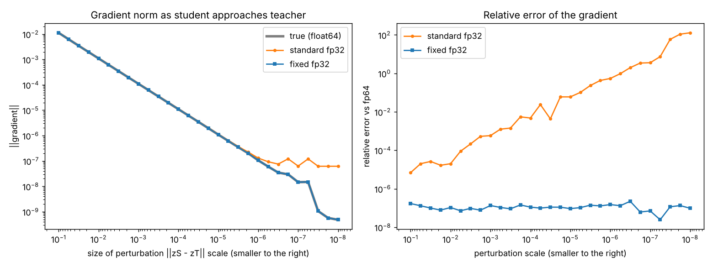
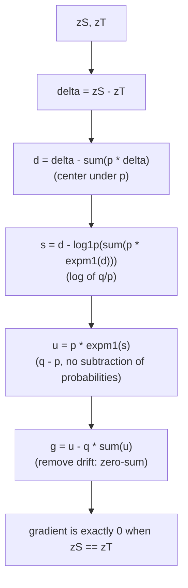
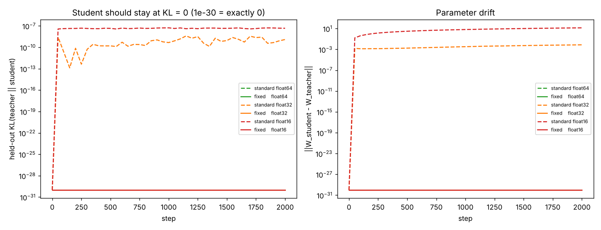

# Guide 05: Bug 2, Softmax Cancellation, and Distillation Drift

**Companion scripts:** [`lesson05_softmax_cancellation.py`](../code/lesson05_softmax_cancellation.py), [`lesson08_distillation_drift.py`](../code/lesson08_distillation_drift.py)
**Paper:** Section 3 (Equations 8 and 9) and Section 7. **Level:** intermediate. **Prerequisites:** Guides 01 to 04.

---

## 1. The claim in one paragraph

In knowledge distillation the target distribution $\mathbf p$ comes from a teacher's logits. When the student's logits $\mathbf z_S$ are close to the teacher's $\mathbf z_T$, the true gradient $\mathbf q-\mathbf p$ is close to zero. Standard code computes $\mathbf q$ and $\mathbf p$ separately, each rounded to a float, then subtracts. Two problems follow: **(i)** the subtraction of nearly equal numbers loses most of its precision, and **(ii)** in autodiff frameworks $\mathbf p$ and $\mathbf q$ are computed by *different sequences of operations*, so the result is not even exactly $\mathbf 0$ when $\mathbf z_S=\mathbf z_T$. Under Adam, a tiny non-zero gradient becomes a real parameter step. The fix computes $\mathbf q-\mathbf p$ directly from $\mathbf z_S-\mathbf z_T$ in log space.

---

## 2. Background you need

### 2.1 Knowledge distillation
A large **teacher** network produces logits $\mathbf z_T$. A smaller **student** is trained to match its output distribution $\mathbf p=\mathrm{softmax}(\mathbf z_T)$ instead of (or in addition to) the hard labels. The student loss is the **soft-target cross-entropy**:

$$\mathcal L(\mathbf z_S,\mathbf z_T)=-\sum_kp_k\mathrm{logsoftmax}(\mathbf z_S)_k,\qquad\mathbf q=\mathrm{softmax}(\mathbf z_S),\qquad\tilde g_k=q_k-p_k .$$

(paper Equation 8). The gradient with respect to the student's logits is $\mathbf q-\mathbf p$ (Guide 03), which equals the gradient of $\mathrm{KL}(\mathbf p\|\mathbf q)$.

### 2.2 Temperature
Teacher outputs are often almost one-hot, which carries little information beyond the label. Dividing logits by a **temperature** $T>1$ softens them (Guide 02, P5). The paper uses $T=4$ in its distillation experiment, so that the scaled margin $m/T$ stays below the bf16 cliff and $\mathbf p$ does not round to one-hot.

### 2.3 Why "student equals teacher" is the right test
If $\mathbf z_S=\mathbf z_T$ then $\mathbf q=\mathbf p$ and the loss is at its minimum. The gradient must be **exactly zero**, and a correct training loop must leave the student unchanged. This is an exact, easy-to-state correctness test.

---

## 3. Where the standard computation goes wrong

### 3.1 Cancellation (problem i)
Let $\boldsymbol\delta=\mathbf z_S-\mathbf z_T$ be small. Then $q_k=p_k(1+\text{something of size }\delta)$. Storing $q_k$ and $p_k$ in float32 keeps about 7 significant digits each. If the relative difference is $10^{-7}$, the subtraction has 1 digit of signal left, with 1 digit of rounding noise in it (Guide 01, section 5).

Lesson 05, three classes, $\mathbf z_T=[2,1,0]$, $\mathbf z_S=\mathbf z_T+[-10^{-7},10^{-7},0]$, float32:

| Method | Gradient |
|---|---|
| fp64 reference | $[-4.596\times10^{-8},\ +4.144\times10^{-8},\ +4.513\times10^{-9}]$ |
| **standard fp32** | $[-5.960\times10^{-8},\ +5.960\times10^{-8},\ 0]$ |
| **fixed fp32** | $[-4.596\times10^{-8},\ +4.144\times10^{-8},\ +4.513\times10^{-9}]$ |

The standard result has wrong magnitudes and a zero where the truth is positive. The fixed result matches the fp64 reference to the printed digits. **[verified here]**

(The paper shows a similar failure for standard JAX code, with different wrong numbers, because operation order differs; the reference gradient is the same.)

### 3.2 Forward/backward mismatch (problem ii)
In typical autodiff code:

* the **forward pass** computes the teacher distribution as `softmax(zT)`;
* the **backward pass** needs $\mathbf q$ and recovers it as `exp(log_softmax(zS))`.

Mathematically identical, but numerically two *different* sequences of rounding. At $\mathbf z_S=\mathbf z_T$ the two disagree in the last bits, so $\mathbf q-\mathbf p\neq\mathbf 0$.

Lesson 05 measures this with `std_soft_target_grad_framework_style` on 200 random float32 teachers with student exactly equal to teacher:

| Implementation | Worst $\lvert g\rvert$ over 200 trials |
|---|---|
| standard (framework style) | $1.19\times10^{-7}$ |
| fixed | **0** exactly |

And in the sweep of lesson 05 (student approaches teacher, float32, 10 classes), the standard gradient norm stops shrinking near $10^{-7}$ to $6\times10^{-8}$ while the true gradient keeps shrinking:



*Left: gradient norm as the student approaches the teacher. The standard implementation flattens at a noise floor; the fixed one follows the truth. Right: relative error against fp64.*

At the smallest scale (perturbation below float32 spacing, so $\mathbf z_S$ and $\mathbf z_T$ are identical) the standard norm is $6.17\times10^{-8}$ and the fixed norm is exactly $0$. **[verified here]**

---

## 4. Why a tiny non-zero gradient is dangerous

Adam divides by the running size of the gradient. If $|g|\gg\epsilon$ (default $\epsilon=10^{-8}$) the step is about the learning rate $\eta$, **whatever the size of $g$** (Guide 06):

$$\text{normalised step}=\frac{|g|}{|g|+\epsilon} .$$

So a spurious per-parameter gradient of $6\times10^{-8}$ would produce a step of $0.86\,\eta$, while the *correct* gradient is $0$ and should produce no step at all. What matters is the gradient that actually reaches the **parameters**, after averaging over the batch. The paper reports a logit residual of about $10^{-3}$ in bf16, far above $\epsilon$ (**[paper]**). In our toy (section 6) the measured normalised step is $0.013$ in float32 and $0.967$ in float16.

---

## 5. The fix, derived step by step

We want $\mathbf u=\mathbf q-\mathbf p$ computed from $\boldsymbol\delta=\mathbf z_S-\mathbf z_T$ without forming two rounded probability vectors.

**1. Express $\mathbf q$ in terms of $\mathbf p$.**
$$q_k=\frac{e^{z_{T,k}+\delta_k}}{\sum_ie^{z_{T,i}+\delta_i}}=\frac{p_ke^{\delta_k}}{\sum_ip_ie^{\delta_i}}\quad\Longrightarrow\quad\frac{q_k}{p_k}=\frac{e^{\delta_k}}{\sum_ip_ie^{\delta_i}} .$$

**2. Remove the redundant shift.** Softmax ignores constant shifts (Guide 02, P3), so shift $\boldsymbol\delta$ to have $p$-weighted mean zero:
$$d_k=\delta_k-\sum_ip_i\delta_i,\qquad\sum_ip_id_i=0 .$$
Then $\dfrac{q_k}{p_k}=\dfrac{e^{d_k}}{\sum_ip_ie^{d_i}}$.

**3. Avoid forming "1 + small".** Write $\sum_ip_ie^{d_i}=1+\sum_ip_i\mathrm{expm1}(d_i)$ (valid because $\sum_ip_i=1$). Take the log of the ratio:
$$s_k=\log\frac{q_k}{p_k}=d_k-\mathrm{log1p}\Big(\sum_ip_i\mathrm{expm1}(d_i)\Big).$$
The argument of `log1p` is $\ge0$: $\mathrm{expm1}(x)\ge x$, so $\sum_ip_i\mathrm{expm1}(d_i)\ge\sum_ip_id_i=0$.

**4. Recover the difference.** $q_k-p_k=p_k(q_k/p_k-1)$, so
$$u_k=p_k\mathrm{expm1}(s_k).$$

**5. Remove drift.** In exact arithmetic $\sum_ku_k=0$. Set
$$g_k=u_k-q_k\sum_iu_i,$$
and since $\sum_kq_k=1$, this gives $\sum_kg_k=0$ regardless of rounding.

Together: paper Equation 9 plus the clean-up. When $\mathbf z_S=\mathbf z_T$: $\boldsymbol\delta=\mathbf 0\Rightarrow\mathbf d=\mathbf 0\Rightarrow\mathbf s=\mathbf 0\Rightarrow\mathbf u=\mathbf 0\Rightarrow\mathbf g=\mathbf 0$ **exactly**, because `expm1(0)` and `log1p(0)` are exactly 0.



### Code reading

```python
def fixed_soft_target_grad(zS, zT):
    p = std_softmax(zT)
    q = np.exp(fixed_log_softmax(zS))
    delta = zS - zT
    d = delta - np.sum(p * delta, axis=-1, keepdims=True)                  # step 2
    s = d - np.log1p(np.sum(p * np.expm1(d), axis=-1, keepdims=True))      # step 3
    u = p * np.expm1(s)                                                    # step 4
    return u - q * np.sum(u, axis=-1, keepdims=True)                       # step 5
```

Notice the pattern: the only inputs that carry information about the *small difference* are `delta` and the arrays derived from it; `p` and `q` appear only as weights.

---

## 6. The distillation experiment (lesson 08)

**Setup (a toy, not the paper's network).** Teacher: a fixed random linear 10-class model on 20 features. Student: a linear model initialised with **exactly** the teacher's weights, so the true gradient is zero. Train with Adam ($\eta=2\times10^{-3}$, $\epsilon=10^{-8}$, no weight decay, 2000 steps) at temperature $T=4$. Compute the gradient in float64, float32 or float16 (a stand-in for low precision; NumPy has no bf16). Track the held-out KL between teacher and student (evaluated in float64) and the weight drift.

**Residual gradient at $\mathbf z_S=\mathbf z_T$** (mean $|g|$ per entry):

| dtype | standard | fixed |
|---|---|---|
| float64 | $1.17\times10^{-17}$ | 0 |
| float32 | $7.27\times10^{-9}$ | 0 |
| float16 | $4.90\times10^{-5}$ | 0 |

**After 2000 Adam steps:**

| variant | final KL | $\lVert W-W_T\rVert$ | "invisible" part | "visible" part | agreement |
|---|---|---|---|---|---|
| standard float64 | 0 | 0 | 0 | 0 | 1.000 |
| standard float32 | $1.25\times10^{-9}$ | $7.5\times10^{-3}$ | $7.5\times10^{-3}$ | $6.4\times10^{-4}$ | 1.000 |
| standard float16 | $4.70\times10^{-8}$ | $13.8$ | $13.8$ | $4.0\times10^{-3}$ | 0.998 |
| **fixed**, all three dtypes | 0 | 0 | 0 | 0 | 1.000 |



**How to read this honestly:**

1. **Float64 standard does not move.** The parameter gradient is about $2\times10^{-19}$, far below $\epsilon$, so Adam's step is essentially 0 (and the tiny update would be smaller than float32 weights can even store). This is consistent with the paper's description for fp64.
2. **Float32 and float16 standard drift** although the true gradient is zero, but by very different amounts. Measured at step 0 (printed by lesson 08): the parameter gradient is $1.3\times10^{-10}$ in float32, giving a normalised step of only $0.013$ (about 1% of $\eta$), and $9.3\times10^{-7}$ in float16, giving $0.967$ (nearly a full step). Averaging over the batch and dividing by $T$ shrinks the logit residual a lot before it reaches the weights, so **where the residual lands relative to $\epsilon$ decides whether Adam amplifies it**.
3. **Most of the drift is "invisible".** Split $\Delta W$ into the part that adds the *same* vector to every class column (which shifts all logits equally, and softmax ignores) and the rest. In float16 the weights move by 13.8 in norm, **all but $4\times10^{-3}$ of it invisible**. The residual does not sum to zero across classes, so Adam pushes every class the same way. This is the zero-sum violation of Guide 04 appearing again.
4. **The effect on the predicted distribution is tiny in this toy** (KL about $5\times10^{-8}$, one test point out of 512 changes its arg-max in float16). The paper reports degraded test accuracy for bf16 in its network. Our toy does **not** reproduce that degradation; it shows the mechanism (spurious gradient, then Adam amplification, then weight drift) without the consequence. **[verified here]** for the mechanism, **[paper]** for the accuracy loss.
5. **Fixed is exactly stationary** in every dtype because the gradient is exactly $\mathbf 0$ and Adam computes $0/(0+\epsilon)=0$.

---

## 7. Is `epsilon` a safety net?

A larger $\epsilon$ suppresses steps from tiny residuals ($|g|\ll\epsilon$ gives step $\approx|g|/\epsilon$). Exercise 1 of lesson 08 invites you to try $\epsilon=10^{-4}$. But raising $\epsilon$ also changes the optimizer's behaviour everywhere else, and, as Guide 07 shows, $\epsilon$ sets where confidence settles ($m^\star\approx\log(1/\epsilon)$). Fixing the numerics is cleaner than compensating with a hyperparameter.

---

## 8. Exercises

1. In lesson 05, switch to `float16` for `zT`, `zS` and compare the noise floor with float32.
2. Show that $\sum_ip_i\mathrm{expm1}(d_i)\ge0$ using Jensen's inequality instead of $\mathrm{expm1}(x)\ge x$.
3. Why can the distillation test not simply compare the *loss values* of standard and fixed? (Hint: the forward values are almost identical; the gradients are what differ.)
4. In lesson 08, perturb the student slightly ($W_S=W_T+10^{-3}\xi$). Do standard and fixed converge to the same KL? Which is more precise?
5. Construct a case with $K=2$ and show the fixed formula reduces to a simple expression in $\sigma$.

<details><summary>Hints and answers to 2 and 3</summary>

2. $\sum_ip_ie^{d_i}\ge e^{\sum_ip_id_i}=e^0=1$ by Jensen (convexity of $e^x$), so $\sum_ip_i\mathrm{expm1}(d_i)=\sum_ip_ie^{d_i}-1\ge0$.
3. The loss $-\sum p_k\log q_k$ is a smooth number around $H(\mathbf p)$; a relative error of $10^{-7}$ is invisible there. The *gradient* is the small difference of two near-equal quantities, which is where the error is amplified.
</details>

---

## 9. Take-aways

1. A gradient that should be zero must be exactly zero for the training loop to stay put. Standard code cannot guarantee that; the fixed code does.
2. Subtracting two rounded probabilities is the wrong way to compute their difference. Compute the difference from $\boldsymbol\delta$ in log space with `expm1` and `log1p`.
3. Adam amplifies numerical noise into steps. Our toy shows the drift mechanism; the paper reports its accuracy consequences.

Next: [Guide 06: Optimizers, Adam and AdamW](06_optimizers_adam_guide.md).
