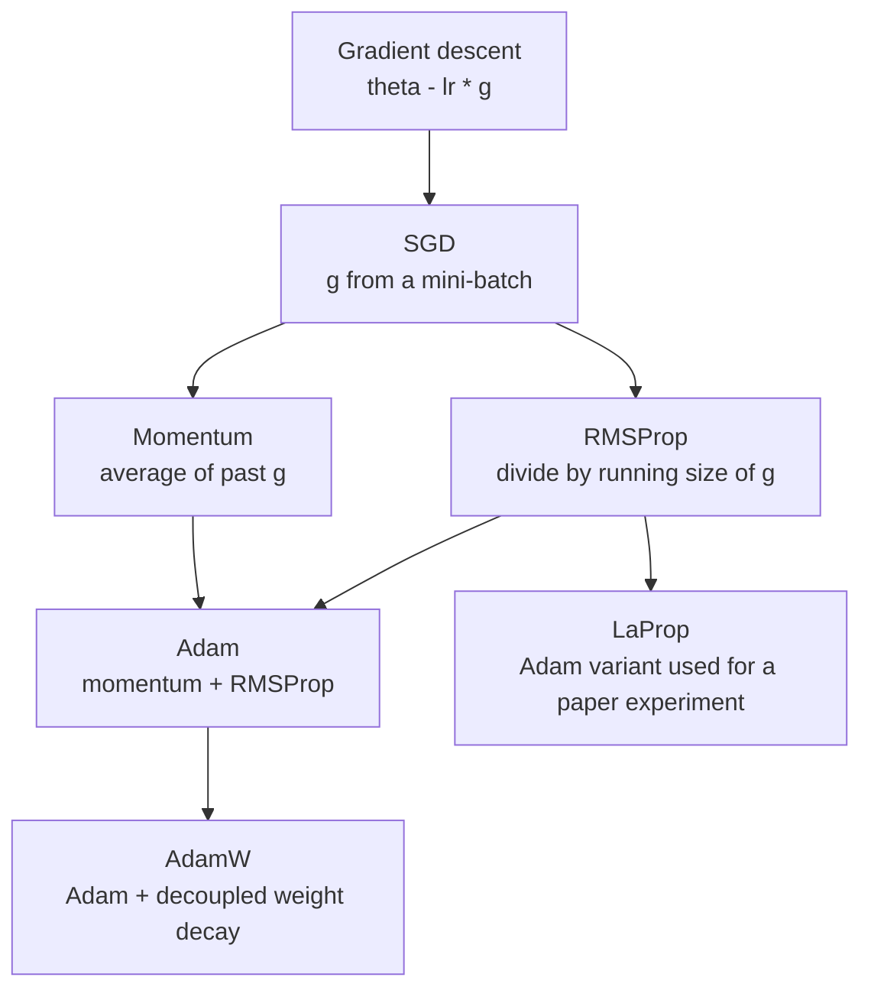
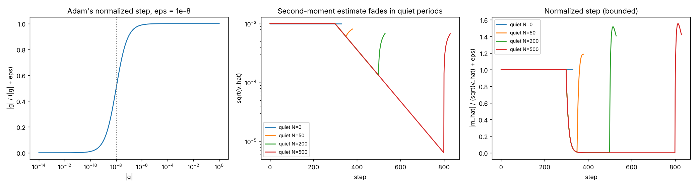
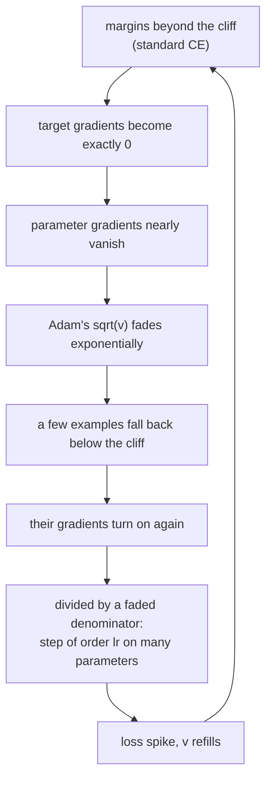

# Guide 06: Optimizers (SGD, Adam, AdamW) and Why Tiny Gradients Can Matter

**Companion script:** [`code/lesson06_adam_from_scratch.py`](../code/lesson06_adam_from_scratch.py), library [`code/optim.py`](../code/optim.py)
**Paper:** Section 4 (the Slingshot mechanism) and Section 5 (equation 10). **Level:** intermediate to advanced.
**Prerequisites:** Guides 03 and 04.

---

## 1. The job of an optimizer

Given a loss $\mathcal L(\boldsymbol\theta)$ and its gradient $\mathbf g=\nabla_{\boldsymbol\theta}\mathcal L$, an optimizer decides **how far and in which direction to move the parameters**. The gradient points uphill; we step downhill.

---

## 2. SGD: the step is proportional to the gradient

$$\boldsymbol\theta\leftarrow\boldsymbol\theta-\eta\,\mathbf g .$$

$\eta$ is the **learning rate**. A gradient 1000 times smaller gives a step 1000 times smaller. Lesson 06 shows it with $f(\theta)=c\theta^2/2$ from $\theta=1$, $\eta=0.1$:

| gradient $c$ | SGD step |
|---|---|
| $10^{-6}$ | $1.0\times10^{-7}$ |
| $1$ | $0.1$ |
| $10^{6}$ | $1.0\times10^{5}$ |

Good: tiny gradients, tiny steps. Bad: step size depends wildly on the scale of the problem, and learning rates must be hand-tuned per problem.

---

## 3. Adam: normalise by the running size of the gradient

Adam keeps two **exponential moving averages** per parameter, with decay rates $\beta_1$ (typically 0.9) and $\beta_2$ (0.98 to 0.999):

$$m\leftarrow\beta_1m+(1-\beta_1)g,\qquad v\leftarrow\beta_2v+(1-\beta_2)g^2 .$$

* $m$ estimates the average **direction** (momentum).
* $v$ estimates the average **squared size**.

Both start at $0$, so early estimates are biased toward 0. **Bias correction** divides by the fraction of the average that has been filled:

$$\hat m=\frac{m}{1-\beta_1^t},\qquad\hat v=\frac{v}{1-\beta_2^t}.$$

Lesson 06 prints the effect for a constant gradient $g=1$ ($\beta_1=0.9$, $\beta_2=0.98$):

| step $t$ | raw $m/\sqrt v$ | corrected |
|---|---|---|
| 1 | 0.707 | 1.000 |
| 2 | 0.955 | 1.000 |
| 5 | 1.321 | 1.000 |

The update divides the direction by the size:

$$\Delta\theta=-\eta\,\frac{\hat m}{\sqrt{\hat v}+\epsilon}.$$

$\epsilon$ (default $10^{-8}$) prevents division by zero.

### 3.1 The key property: scale-free steps

If $|g|$ is consistent and $\gg\epsilon$, then $\hat m\approx g$ and $\sqrt{\hat v}\approx|g|$, so the ratio is $\pm1$ and the step has size $\approx\eta$, **no matter how big or small $g$ is**. Lesson 06 (Adam, $\epsilon$ tiny, one step, $\eta=0.1$):

| gradient | Adam step |
|---|---|
| $10^{-6}$ | $0.100000$ |
| $1$ | $0.100000$ |
| $10^{6}$ | $0.100000$ |

This is why Adam is easy to tune, and also why **numerical noise in a gradient can be turned into a real parameter move**.

### 3.2 Where $\epsilon$ matters

For $|g|\gg\epsilon$ the step is $\approx\eta$; for $|g|\ll\epsilon$ it is $\approx\eta\,|g|/\epsilon$ (proportional again). The transition is smooth:

$$\text{normalised step}\;\approx\;\frac{|g|}{|g|+\epsilon}.$$

With $\epsilon=10^{-8}$ (lesson 06):

| $\lvert g\rvert$ | step / $\eta$ |
|---|---|
| $10^{-3}$ | 1.000 |
| $10^{-6}$ | 0.990 |
| $10^{-8}$ | 0.500 |
| $10^{-10}$ | 0.010 |

*Left: the normalised step as a function of $|g|$. Middle and right: second-moment estimate and step during and after a stretch with zero gradient (section 5).*

---

## 4. AdamW and weight decay

**Weight decay** shrinks parameters a little every step to keep them small. In AdamW it is applied **decoupled** from the gradient normalisation. The paper writes the update as

$$\boldsymbol\theta\leftarrow\boldsymbol\theta-\eta\Big(\frac{\hat{\mathbf m}}{\sqrt{\hat{\mathbf v}}+\epsilon}+\lambda\boldsymbol\theta\Big),$$

with weight-decay coefficient $\lambda$. This is what `optim.AdamW` implements. Setting $\lambda=0$ gives plain Adam.

---

## 5. A quiet period: what happens to $v$ when gradients vanish

Suppose the gradient is steady, then exactly zero for $N$ steps, then returns. During the quiet period:

* $v$ is multiplied by $\beta_2$ every step, so $\sqrt{\hat v}$ shrinks like $\beta_2^{N/2}$ (for $\beta_2=0.98$, like $0.99^N$).
* $m$ is multiplied by $\beta_1=0.9$ every step, so it dies out faster.

Lesson 06, steady $g=10^{-3}$ for 300 steps, then zero for $N$ steps, then $10^{-3}$ again ($\beta_1=0.9,\ \beta_2=0.98,\ \epsilon=10^{-8}$):

| quiet steps $N$ | $\sqrt{\hat v}$ just before resuming | normalised step right after resuming |
|---|---|---|
| 0 | $1.000\times10^{-3}$ | 1.000 |
| 50 | $6.03\times10^{-4}$ | 0.171 |
| 200 | $1.33\times10^{-4}$ | 0.518 |
| 500 | $6.40\times10^{-6}$ | 0.706 |

Predicted decay $0.99^N$: $0.605$ at $N=50$, $0.134$ at $N=200$, $0.0066$ at $N=500$, matching the ratios in the table (0.603, 0.133, 0.0064). **[verified here]**

As $v$ fades, the step after resuming approaches the bound
$$\frac{1-\beta_1}{\sqrt{1-\beta_2}}=\frac{0.1}{\sqrt{0.02}}=0.707 ,$$
which is exactly the $N=500$ value. **[derived]** and **[verified here]**.

**What this does and does not establish about the Slingshot.** The paper (Section 4) explains Slingshot spikes as follows: when every example in a batch is beyond the cliff, the standard code zeroes the target gradients, parameter gradients nearly vanish, $\hat v$ decays; later weight decay or residual updates pull a few examples back below the cliff, their target gradients switch on again, Adam divides by a faded denominator and takes a large step, which spikes the loss and restarts the cycle. This script verifies the **per-parameter** facts: $\hat v$ does fade exponentially and the restored step is bounded by about $0.71\eta$, not unbounded. Whether many parameters stepping together at that size cause a **loss spike** depends on the network and is shown by the paper's experiments, **not** by this kit. **[paper]**

---

## 6. The AdamW stationary point (used in Guide 07)

When parameters stop moving, $\hat m_i\to g_i$ and $\sqrt{\hat v_i}\to|g_i|$, and the update is zero:

$$\frac{g_i}{|g_i|+\epsilon}+\lambda\theta_i=0\qquad\text{(paper, Equation 10)}.$$

Notice that $\eta,\beta_1,\beta_2$ have cancelled. Two regimes:

* $|g_i|\gg\epsilon$: the first term has magnitude $\approx1$. A balance requires $\lambda|\theta_i|\approx1$, i.e. $|\theta_i|\approx1/\lambda$.
* $|g_i|\ll\epsilon$: the first term is $\approx g_i/\epsilon$. A balance requires $|g_i|\approx\epsilon\lambda|\theta_i|$.

The second regime is the one that determines where a very confident network stops pushing its margin up (Guide 07).

---

## 7. LayerNorm and effective learning rate (context for the paper)

**LayerNorm** rescales a layer's activations to a fixed scale. If a LayerNorm sits between some weights and the logits, then multiplying those weights by a constant does not change the logits, but it does change how far a gradient step of fixed size $\eta$ moves the *function*: the **effective learning rate** is about $\eta/\lVert\boldsymbol\theta\rVert_2$. Larger weights mean smaller effective steps. The paper uses this to explain why Slingshot spikes (which inflate $\lVert\boldsymbol\theta\rVert_2$) can look like a helpful accidental learning-rate decay in setups without weight decay, but destructive in others (Guide 07). **[paper]**

---

## 8. Common misconceptions

| Misconception | Reality |
|---|---|
| "Adam is SGD with a better learning rate." | Adam's step is normalised by gradient size; SGD's is not. They behave differently when gradients are tiny. |
| "Tiny gradient means the model has converged." | Under Adam, a consistent tiny gradient still produces steps of about $\eta$ until it falls well below $\epsilon$. |
| "$\epsilon$ is just a numerical safeguard." | It sets the scale below which gradients stop being amplified, so it shapes the equilibrium of confident models (Guide 07). |
| "Weight decay and L2 regularisation are identical." | For plain SGD they coincide. For Adam they differ; AdamW applies the decay outside the normalisation. |

---

## 9. Exercises

1. Minimise $f(x)=x^2$ from $x=5$ with SGD and with Adam (both $\eta=0.1$) using `optim.py`. Plot both trajectories.
2. Set $\beta_2=0.999$ in section 5's experiment. How long until $\sqrt{\hat v}$ has faded by a factor 10?
3. Why would $\epsilon=0$ divide by zero when $g=0$ for long enough?
4. For $g_i=10^{-12}$, $\epsilon=10^{-8}$, $\eta=10^{-3}$, what is the step size?
5. Show that the stationary condition with $|g|\ll\epsilon$ gives $|g|\approx\epsilon\lambda|\theta|$.

Answers to 2, 4 and 5

2. $\sqrt{\hat v}$ shrinks like $\beta_2^{N/2}=0.999^{N/2}$. Factor 10 requires $0.999^{N/2}=0.1$, $N=2\ln0.1/\ln0.999\approx4600$ steps.
4. Step $\approx\eta\,|g|/(|g|+\epsilon)\approx10^{-3}\times10^{-12}/10^{-8}=10^{-7}$.
5. With $|g|\ll\epsilon$, $|g|+\epsilon\approx\epsilon$, so the condition reads $g/\epsilon+\lambda\theta=0$, i.e. $g=-\epsilon\lambda\theta$.

---

## 10. Take-aways

1. Adam's step is $\approx\eta$ for any consistent gradient above $\epsilon$, and shrinks proportionally below $\epsilon$.
2. That makes tiny, wrong gradients dangerous (Guide 05) and makes $\epsilon$ a physical constant of the training dynamics.
3. After a quiet period $\hat v$ fades like $\beta_2^N$; the per-parameter step is bounded by about $0.71\eta$. The paper's loss spikes are a network-level consequence reported from experiments, not shown here.

Next: [Guide 07: Grokking, Slingshot and margin equilibria](07_grokking_slingshot_equilibria.md).
