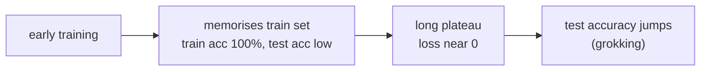
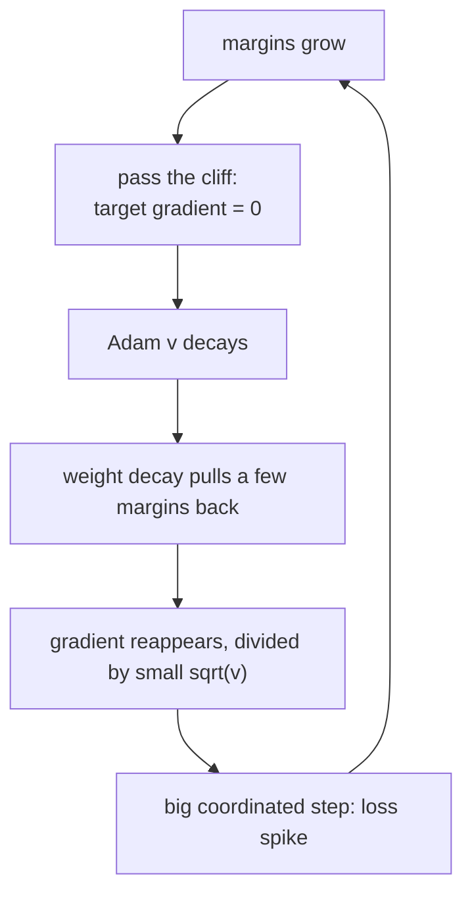
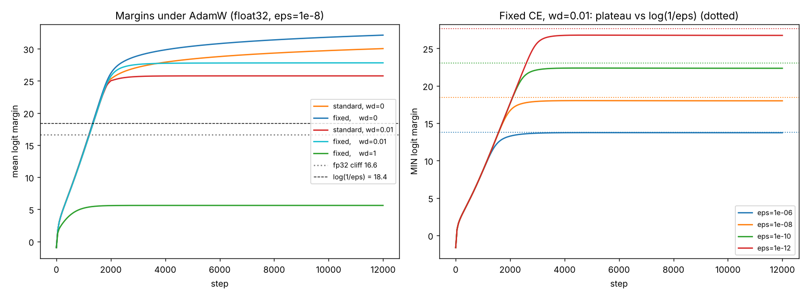

# Guide 07: Grokking, the Slingshot Mechanism and Margin Equilibria

**Companion script:** [`code/lesson07_margin_growth.py`](../code/lesson07_margin_growth.py) (about 30 seconds)
**Paper:** Sections 4 to 6 (Slingshot, Equations 10 and 11, Table 1). **Level:** intermediate to advanced.
**Prerequisites:** Guides 03, 04 and 06.

Every claim below carries a tag: **[derived]** (follows from algebra on this page), **[verified here]** (printed by a script in this kit), or **[paper]** (reported by the authors, not reproduced here).

---

## 1. What is grokking?

A network is trained on a small dataset. It first **memorises** the training set (training accuracy reaches 100%) while held-out accuracy stays poor. Then, long after the training loss is almost zero, held-out accuracy suddenly rises. That delayed jump is called **grokking**.

Grokking is usually studied on **modular arithmetic**: predict $(a+b)\bmod p$ from the pair $(a,b)$. With $p=31$ there are $31\times31=961$ pairs; a fraction is used for training and the rest for testing. The paper uses this task with a one-layer, width-64 Transformer trained with AdamW ($\eta=10^{-3}$, $\beta_2=0.98$, $\lambda=1$). **[paper]**

Why is it a good probe for this paper? Because the model reaches a very confident state (huge margins) early, and then trains for a long time in exactly the regime where the standard softmax cross-entropy goes numerically wrong (Guides 04 and 05).

---

## 2. The Slingshot mechanism, step by step

Earlier work observed periodic **loss spikes** ("slingshots") during long training with Adam and cross-entropy, and a link between them and grokking. The paper's explanation is that the spikes are a numerical artefact, not a property of the data. **[paper]**

The chain, with the guide that supports each link:

1. Margins grow because the loss rewards confidence (Guide 03). **[derived]**
2. Past the precision cliff $c=(p+1)\ln2$ (5.55 for bf16, 16.64 for fp32), the standard code makes the target gradient exactly 0 (Guide 04). **[verified here]**
3. If every example in a batch is past the cliff, parameter gradients nearly vanish and Adam's $\hat v$ decays like $\beta_2^N$ (Guide 06). **[verified here, per parameter]**
4. Weight decay or residual updates pull some margins back below the cliff; their gradients switch on; Adam divides by a faded denominator and takes a step of up to about $0.71\eta$ on many parameters at once. The per-parameter bound is **[verified here]**.
5. The combined step spikes the loss, then the cycle repeats. **[paper]**

**What this kit does not show.** The toy model in lesson 07 does not reproduce spikes, grokking, or any accuracy loss. Accuracy stays at 100% and the loss never spikes in the runs below. Treat the Slingshot as the paper's claim, backed by its network experiments. The kit verifies the ingredients (the cliff, the zero gradient, the Adam facts), not the spike itself. **[verified here]**

---

## 3. The equilibrium: where does the margin stop growing?

Even with the fixed loss, margins cannot grow forever. Two forces balance: the loss gradient pushes margins up, weight decay pulls weights down.

Use the AdamW stationary condition from Guide 06 (paper Equation 10):

$$\frac{g_i}{|g_i|+\epsilon}+\lambda\theta_i=0 .$$

For a confident model, the gradient is tiny: $|g_i|\propto e^{-m}$ (Guide 03). Once $|g_i|\ll\epsilon$, the condition reads $|g_i|\approx\epsilon\lambda|\theta_i|$. Keep only the order of magnitude, treat $\lambda|\theta_i|$ as order 1, and set $e^{-m}\approx\epsilon$:

$$\boxed{\,m^\star\approx\log\frac1\epsilon\,}\qquad\text{(paper, Equation 11)}.$$

This is a heuristic scaling argument **[derived]**, not an exact formula. It predicts the margin scale by the Adam constant $\epsilon$, not by the data.

Numbers: $\epsilon=10^{-8}$ gives $\log(1/\epsilon)=18.42$. For fp32 the cliff is 16.64, so the equilibrium sits just beyond the cliff, where the standard code is already blind. For bf16 the cliff (5.55) is far below. **[derived]**

---

## 4. What lesson 07 measures

The toy: a linear softmax classifier on separable data, trained with AdamW, in float32. Two losses compared: standard (`std_cross_entropy`) and fixed (`fixed_cross_entropy`). The statistic is the final **mean margin** over training examples. **[verified here]**

### 4.1 Weight-decay configurations

| setting | standard final mean margin | fixed final mean margin |
|---|---|---|
| $\lambda=0$ | 30.03 | 32.12 |
| $\lambda=0.01$ | 25.78 | 27.81 |
| $\lambda=1$ | 5.61 (max $\lvert W\rvert=1.00$) | 5.61 |

Reading it:

* With little or no weight decay, margins keep growing to about 30, well beyond the fp32 cliff 16.64. The fixed loss still gives a gradient there, so it ends slightly higher.
* With $\lambda=1$ the weights are capped near $1/\lambda=1$ (the $|g|\gg\epsilon$ regime of section 3), and the margin is limited by the weight scale of this small model, not by the loss. Both losses agree.

### 4.2 Sweeping $\epsilon$ ($\lambda=0.01$, fixed loss)

| $\epsilon$ | $\log(1/\epsilon)$ | minimum margin | mean margin |
|---|---|---|---|
| $10^{-6}$ | 13.82 | 13.72 | 21.58 |
| $10^{-8}$ | 18.42 | 17.99 | 27.81 |
| $10^{-10}$ | 23.03 | 22.34 | 34.16 |
| $10^{-12}$ | 27.63 | 26.74 | 40.57 |

The **minimum** margin (the least confident example) tracks $\log(1/\epsilon)$ closely, within about 1. The **mean** margin sits higher because easy examples are pushed further. So the scaling $m^\star\approx\log(1/\epsilon)$ is supported as a statement about where the weakest examples settle. **[verified here]**

### 4.3 Is it just luck? Five seeds, $\epsilon=10^{-8}$, $\lambda=0.01$

| loss | minimum margin range over 5 seeds |
|---|---|
| standard | 16.24 to 16.99 |
| fixed | 17.05 to 18.10 |

Both reach close to or beyond the fp32 cliff, and the fixed loss is consistently a little higher, with the ranges only just separated. In this toy the difference is small and no accuracy is lost either way. **[verified here]**

---

## 5. What the paper reports for its network

All **[paper]**, none reproduced here:

* **Table 1**: final margins. The fixed loss reaches 17.9, 27.4 and 36.8 in the three settings of the table. Standard float32 reaches 13.0, 15.1 and 12.7, and standard bf16 reaches 5.1, 5.6 and 5.8, so low precision caps the margin near the cliff. Standard float64 reaches 17.9, 27.4 and 30.1, i.e. it matches the fixed loss in the first two settings. See the paper for the exact definition of each column.
* **Slingshot removal**: with the fixed loss the spikes disappear, and the paper reports accuracy comparisons such as 94 ± 5% against 100 ± 0% in its grokking runs. Check the paper's Section 5 for the precise settings behind each figure.
* **Baselines**: a zero-sum projection of the gradient and the StableMax alternative are compared in the same table.

---

## 6. Verified versus paper

| Claim | Status |
|---|---|
| The cliff values 5.55 / 16.64 / 36.74 | [verified here] |
| Standard CE gives exactly zero target gradient past the cliff | [verified here] |
| Adam $\hat v$ decays like $\beta_2^N$ in a quiet period, step bounded by about $0.71\eta$ | [verified here] |
| Minimum margin tracks $\log(1/\epsilon)$ in the toy | [verified here] |
| Fixed loss ends with slightly higher margins than standard in the toy | [verified here] |
| Slingshot loss spikes are caused by this numerical chain | [paper] |
| Spikes vanish, grokking behaviour changes with the fixed loss | [paper] |
| Table 1 margins | [paper] |

---

## 7. Common misconceptions

| Misconception | Reality |
|---|---|
| "Grokking proves the network suddenly understood." | It is a delayed jump in held-out accuracy. What drives it is still debated; this paper argues the spikes around it are numerical. |
| "A zero loss means training can stop." | The loss is never exactly zero in exact arithmetic; the weights keep moving, and margins keep growing until an equilibrium. |
| "The equilibrium margin depends on the data." | The heuristic says it depends mainly on $\epsilon$ and the weight-decay balance. |
| "This toy proves the paper." | It only checks the ingredients on a small model. |

---

## 8. Exercises

1. Run lesson 07 with $\epsilon=10^{-7}$. Predict the minimum margin before running.
2. Change $\lambda$ to 0.1. Which regime of section 3 applies?
3. Why does the standard loss still make progress in float32 when its margin is between 16 and 17?
4. Explain why the mean margin is higher than the minimum margin.

Answers to 1 and 3

1. $\log(10^7)=16.12$; expect a minimum margin slightly below it (the sweep shows about 0.1 to 0.9 lower).
3. Just below the cliff the term $1-q_t$ is rounded with large relative error but is not yet zero, so a noisy gradient can still reach the optimizer. Check this with lesson 04.

---

## 9. Take-aways

1. Margins grow until weight decay and Adam's $\epsilon$ balance, at roughly $\log(1/\epsilon)$.
2. Standard softmax cross-entropy goes blind near that scale in fp32 and far below it in bf16.
3. The toy verifies the ingredients; the Slingshot and grokking effects are the paper's network-level results.

Next: [Guide 08: Teaching guide](08_teaching_guide.md).
